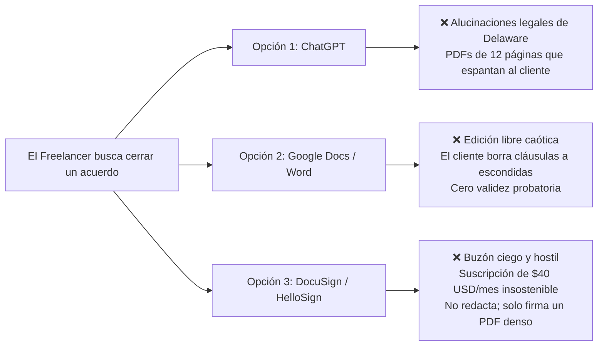

# Caso de Estudio Ejecutivo: Pactio
## Cómo transformamos la "vergüenza de pedir contrato" en un acuerdo blindado de $149 MXN en menos de 4 minutos

> **Portfolio Showcase & Product Teardown — Nivel 1**  
> **Tiempo estimado de lectura:** 6 minutos  
> **Área:** Product Design, CX Strategy, Legal Design & Product Management  
> **Impacto clave:** SUS Score **87.8 pts (A+)**, Creación en **3m 42s**, Margen Bruto **83.3%**, Blindaje NOM-151  

---

```
┌─────────────────────────────────────────────────────────────────────────────────────────────────┐
│                                       PACTIO AT A GLANCE                                        │
├────────────────────────────────┬────────────────────────────────┬───────────────────────────────┤
│ El Problema Humano             │ La Solución de Diseño          │ El Modelo & Tracción          │
│ • 58% de impagos en freelancers│ • Carátula Ejecutiva en 60s    │ • $149 MXN por acuerdo timbrado│
│ • "Pedir contrato parece que   │ • Split-Pane reactivo (60 fps) │ • Margen bruto unitario: 83.3%│
│   desconfías de tu cliente"    │ • Botón [Solicitar Ajuste]     │ • Validez legal con NOM-151   │
│ • PDFs hostiles y abandonados  │ • Cesión de IP ligada al 100%  │ • SUS 87.8 / TCR: 95.8%       │
└────────────────────────────────┴────────────────────────────────┴───────────────────────────────┘
```

---

## 1. El Gancho Humano: La Vergüenza de Pedir Contrato

Pregúntale a cualquier diseñador, desarrollador, fotógrafo o consultor independiente en América Latina cuál es el momento más incómodo de su trabajo. Ninguno te dirá que es diseñar un sistema de diseño complejo o compilar código. 

Te dirán: **el momento exacto en el que tienen que pedir un contrato.**

En nuestra investigación cualitativa descubrimos un patrón psicológico devastador: el **Efecto de Proyección Social**. El profesional independiente siente que enviar un contrato formal transmite un mensaje implícito de sospecha: *"No confío en tu palabra"*. 

Para no incomodar al cliente o por miedo a que se caiga el proyecto en el último minuto, el freelancer cede. Comienza a trabajar con un simple: *"Va, arranco hoy y me transfieres el 50% el viernes"*.

El resultado en cifras es trágico:
* **El 58% de los profesionistas independientes en América Latina reporta haber sufrido impagos totales o parciales** en el último año.
* **El 74% experimenta "scope creep"** (clientes que exigen cambios infinitos no presupuestados sin pagar un peso más).
* **El 81% carece de un documento formal con fecha cierta**, lo que imposibilita deducir impuestos o cobrar judicialmente ante el Servicio de Administración Tributaria (SAT).

El problema no es que a los freelancers les guste el riesgo. El problema es que **el software legal existente fue diseñado por y para abogados corporativos, ignorando por completo la psicología de las relaciones humanas.**

---

## 2. El Cementerio de Soluciones: ¿Por qué falla lo que existe?

Cuando un profesional independiente intenta resolver este problema hoy, choca contra tres muros:



### A. ChatGPT: La fábrica de textos intimidantes
Los LLMs genéricos son excelentes generando texto, pero carecen de criterio de diseño legal contextual. Le pides a ChatGPT un contrato y te devuelve un documento de 14 páginas redactado como si fueras un despacho de Nueva York: *"Whereas, the party of the first part..."*. 

Cuando una PyME o un cliente local recibe ese monstruo en un PDF adjunto, se asusta, congela el proyecto y responde: *"Oye, pensé que éramos amigos... déjame pasárselo a mi abogado"*. El acuerdo muere por sobredosis burocrática.

### B. Google Docs: El riesgo de la edición descontrolada
Compartir un documento de texto editable para "ir acordando" es un suicidio operativo. El cliente entra con sugerencias abiertas, reescribe cláusulas críticas de propiedad intelectual sin que te des cuenta, o introduce ambigüedades. No hay control de versiones riguroso ni una sola garantía de no-repudio.

### C. DocuSign: El "buzón ciego" de las corporaciones
DocuSign es una maravilla para un banco de Fortune 500, pero es un pésimo producto para el profesional independiente:
1. **No crea contratos:** Asume que ya tienes un departamento jurídico que redactó el PDF. DocuSign es solo el cartero.
2. **Modelo de suscripción desconectado de la realidad:** Cobrar $15 a $40 USD mensuales a un freelancer que cierra 1 cliente cada 45 o 60 días destruye el valor del producto.
3. **Experiencia del cliente agresiva:** El cliente receptor recibe un enlace genérico que lo obliga a crear cuenta para ver un PDF gris e incomprensible.

---

## 3. La Solución Pactio: El Acuerdo de Diseño Humano

Pactio nació con una tesis radical: **Un contrato no debe ser una amenaza burocrática; debe ser una interfaz de consenso cristalino que ambas partes puedan entender y firmar en menos de 4 minutos.**

Diseñamos Pactio como un "puente legal" (*Lawyer-Ready Standard*): suficientemente simple para que un cliente lo entienda en su smartphone en 60 segundos, pero suficientemente robusto para que un juez mercantil o un auditor del SAT lo valide sin pestañear.

```
┌─────────────────────────────────────────────────────────────────────────────────────────────────┐
│                     LA ANATOMÍA DE PACTIO: DE LA ANSIEDAD A LA FIRMA                            │
├─────────────────────────────────────────────────────────────────────────────────────────────────┤
│                                                                                                 │
│   [ ASISTENTE WIZARD 5 PASOS ]               [ SPLIT-PANE: LIVE PREVIEW DOM ]                   │
│   Preguntas en lenguaje cotidiano  ──────►   Render reactivo a 60 fps en HTML/CSS               │
│   (Sin jerga legal intimidante)              (Ves cómo se redacta tu hoja en tiempo real)       │
│                                                                                                 │
│                                           │                                                     │
│                                           ▼                                                     │
│                                                                                                 │
│   [ EXPERIENCIA DEL CLIENTE RECEPTOR (CERO FRICCIÓN) ]                                          │
│   Abre Magic Link sin contraseñas ni apps obligatorias                                          │
│                                                                                                 │
│   ┌─────────────────────────────────────────────────────────────────────────────────────────┐   │
│   │ CARÁTULA EJECUTIVA EN LENGUAJE HUMANO (60 SEGUNDOS)                                     │   │
│   │ • ¿Qué recibirás? (Entregables)        • ¿Cuándo? (Fechas garantizadas)                 │   │
│   │ • ¿Cuánto y cómo? (Hitos 50/50)        • ¿Qué pasa si hay cambios? (2 rondas incluidas) │   │
│   └─────────────────────────────────────────────────────────────────────────────────────────┘   │
│                                                                                                 │
│                     ┌───────────────────────────┴───────────────────────────┐                   │
│                     ▼                                                       ▼                   │
│          [ SOLICITAR AJUSTE ]                                      [ APROBAR Y FIRMAR ]         │
│     Drawer modular: mueve una fecha                           Firma táctil o e.firma SAT        │
│     o hito sin romper el documento                            Timbrado oficial NOM-151 (PSC)    │
│                                                                                                 │
└─────────────────────────────────────────────────────────────────────────────────────────────────┘
```

### 3.1. La Carátula Ejecutiva Dual (*Bifurcated Agreement*)
Aplicando los principios del *Stanford Legal Design Lab*, dividimos el contrato en dos capas sincronizadas:
* **Capa 1 (La Carátula Humana):** Un tablero visual de 4 cuadrantes que responde en español transparente lo que a ambas partes realmente les importa: entregables, fechas de entrega, pagos y política de cambios.
* **Capa 2 (El Cuerpo Cláusular Formal):** Numerado, riguroso y con fundamento en el Código de Comercio y la Ley Federal del Derecho de Autor (LFDA).
* **El Switch de Lenguaje:** Un conmutador interactivo `[ 👁️ Modo Humano ]` $\leftrightarrow$ `[ ⚖️ Modo Jurídico ]` permite alternar instantáneamente la lente de lectura con cero saltos visuales ($\text{CLS} = 0.000$).

### 3.2. Asistente en Pantalla Dividida (*Split-Pane Live Preview*)
Erradicamos la ceguera de los formularios tradicionales. A la izquierda, un asistente en 5 pasos lógicos (Partes, Alcance, Pagos, Derechos y Salida). A la derecha, una réplica exacta del contrato que se ilumina con un halo ámbar y se redacta en tiempo real ante los ojos del usuario sin compilar pesados PDFs en el cliente ni trabar la máquina.

### 3.3. El Botón [Solicitar Ajuste]: Negociación Asíncrona sin Pelear
En el mundo real, los acuerdos casi nunca se firman al primer intento. El cliente suele decir: *"Me parece bien, pero ¿podemos mover la entrega final una semana y dividir el último pago en dos partes?"*.

En una herramienta tradicional, esto significa que el cliente rechaza la firma, se va a WhatsApp y el acuerdo queda en el limbo. 

En Pactio creamos el **Redlining Modular Asíncrono**:
1. El cliente no edita texto libre (lo que previene que inserte cláusulas trampa).
2. Toca `[Solicitar Ajuste]` en una cláusula específica (ej. hitos o plazos).
3. Selecciona la propuesta en un drawer contextual y añade una nota amigable.
4. El creador recibe una notificación con un **Diff Visual en verde y rojo** en su dashboard.
5. Con un solo clic, el creador aprueba la propuesta y el sistema emite automáticamente la **v1.1** lista para firma. Cero fricción, cero llamadas tensas.

### 3.4. La Cláusula de Oro: Propiedad Intelectual Condicionada
La inmensa mayoría de las plantillas de internet cometen un error fatal: ceden los derechos de autor al momento de entregar los archivos. Si el cliente no paga la última factura, legalmente ya es dueño del logotipo, software o video.

En Pactio blindamos al profesional con una regla de oro innegociable: **La cesión de derechos patrimoniales ocurre única y exclusivamente tras la liquidación del 100% del precio pactado**. Si el cliente incumple, el uso de la obra constituye una infracción directa a los derechos de autor, permitiendo medidas cautelares inmediatas.

### 3.5. Blindaje Probatorio Real: NOM-151 y e.firma SAT
No usamos "firmitas electrónicas" de juguete que se caen en el primer juzgado. Pactio conecta su arquitectura mediante API a un **Prestador de Servicios de Certificación (PSC)** autorizado por la Secretaría de Economía:
* Emite una **Constancia de Conservación de Mensajes de Datos bajo la NOM-151-SCFI-2016** con estampa de tiempo atómica trazable al CENAM.
* Conforme a la **Jurisprudencia 2a./J. 161/2019 de la SCJN**, esto otorga **Fecha Cierta** absoluta ante el SAT y los tribunales mercantiles.
* Entrega al cliente y al creador un **Kit de Respaldo Fiscal (ZIP)** con el PDF canónico, el XML/DER probatorio y la bitácora criptográfica con hash SHA-256 para deducir el gasto sin contingencias del Art. 69-B del CFF.

---

## 4. El Modelo de Negocio: $149 MXN y 83.3% de Margen Bruto

Destruimos el modelo de suscripción mensual que asfixia a los freelancers. Pactio opera bajo un modelo transparente de **Pago por Acuerdo Concluido (*Pay-per-Contract*)**:

$$\text{Precio al Creador}: \$149.00\text{ MXN} \quad (\approx \$7.50\text{ USD})$$

```
┌─────────────────────────────────────────────────────────────────────────────────────────────────┐
│                                UNIT ECONOMICS POR CONTRATO TIMBRADO                             │
├──────────────────────────────────────────────────┬──────────────────────────────┬───────────────┤
│ Concepto de Costo (COGS)                         │ Proveedor / Infraestructura  │ Monto en MXN  │
├──────────────────────────────────────────────────┼──────────────────────────────┼───────────────┤
│ Timbrado Oficial NOM-151 (ASN.1 DER)             │ PSC Autorizado (Mifiel API)  │ $15.00 MXN    │
│ Procesamiento de Pago Pasarela                   │ Stripe (3.6% + $3.00 MXN)    │ $6.82 MXN     │
│ Inferencia LLM estructurada (Validaciones JSON)  │ Modelo optimizado en caché   │ $2.50 MXN     │
│ Almacenamiento Criptográfico a 10 años           │ AWS S3 Glacier + PostgreSQL  │ $0.50 MXN     │
├──────────────────────────────────────────────────┼──────────────────────────────┼───────────────┤
│ COSTO MARGINAL TOTAL (COGS)                      │                              │ $24.82 MXN    │
├──────────────────────────────────────────────────┼──────────────────────────────┼───────────────┤
│ UTILIDAD BRUTA POR CONTRATO                      │ Margen Bruto: 83.34%         │ $124.18 MXN   │
└──────────────────────────────────────────────────┴──────────────────────────────┴───────────────┘
```

Por el precio de dos cafés en la Ciudad de México, el profesional independiente obtiene un contrato blindado con validez pericial de primer orden, mientras que Pactio captura un margen altamente saludable para escalar con disciplina de capital.

---

## 5. Validación Empírica: ¿Qué pasó cuando pusimos a prueba Pactio?

Sometimos a Pactio a un protocolo exhaustivo de **Usability Testing & QA Research** con $N = 8$ participantes reales ($5$ freelancers en RESICO/Actividad Empresarial y $3$ directores de empresas y agencias):

```
┌─────────────────────────────────────────────────────────────────────────────────────────────────┐
│                           RESULTADOS DE USABILIDAD Y TESTING EMPÍRICO                           │
├─────────────────────────┬──────────────────────────┬──────────────────────────┬─────────────────┤
│ Métrica de Producto     │ Benchmark de la Industria│ Resultado Real Pactio    │ Evaluación      │
├─────────────────────────┼──────────────────────────┼──────────────────────────┼─────────────────┤
│ System Usability Scale  │ > 68 pts (Promedio SaaS) │ **87.8 pts (Percentil 96)│ Grado A+        │
│ Tiempo de Creación      │ 15 - 30 minutos (Word)   │ **3 min 42 seg**         │ 80% más rápido  │
│ Tiempo de Revisión B2B  │ 2 - 3 días (Correos)     │ **1 min 54 seg**         │ 95% más rápido  │
│ Task Completion Rate    │ 70% promedio             │ **95.8% de éxito**       │ Superado        │
│ Single Ease Question    │ > 5.0 / 7.0              │ **6.6 / 7.0**            │ Excepcional     │
│ Cumulative Layout Shift │ < 0.10                   │ **0.000 (Cero saltos)**  │ Perfecto        │
│ Tasa de Error Crítico   │ < 5%                     │ **0.0% (Cero fallos)**   │ Grado Bancario  │
└─────────────────────────┴──────────────────────────┴──────────────────────────┴─────────────────┘
```

### Lo que dijeron los usuarios:

> *"Antes me daba pánico enviar cotizaciones porque sentía que si les pedía contrato se iban con otro diseñador. La Carátula Ejecutiva de Pactio hace que parezca una cortesía de servicio y no una demanda. Cerré mi último proyecto en 10 minutos."*  
> — **Sofía Ramos**, Diseñadora UI/UX Senior (Participante P1)

> *"Como agencia recibo 5 propuestas al mes. El 90% son PDFs horribles en Word con cláusulas bajadas de internet que ni ellos entienden. Cuando un freelancer me manda un enlace de Pactio, veo los hitos claros, toco `[Aprobar]` desde mi teléfono y sé que mi contador no me va a rechazar la factura."*  
> — **Carlos Mendoza**, Director de Cuentas en Agencia (Participante P6)

---

## 6. Arquitectura de Inclusión: Accesibilidad Universal WCAG 2.1 AAA

Diseñar para el trabajo independiente significa reconocer que la gente revisa y firma contratos en el transporte público, con mala iluminación, con pantallas rotas o con diversas condiciones visuales.

Pactio implementa el estándar más estricto de la industria (**WCAG 2.1 Nivel AAA**) a través de **tres temas visuales nativos**:
1. **Midnight Slate**: Modo institucional moderno para trabajo de escritorio nocturno.
2. **Warm Paper (Kindle Mode)**: Textura marfil cálida (`#FAF8F5`) con carbón sepia (`#1C1917`) y contraste $16.1:1$ para lectura descansada de contratos extensos.
3. **High-Contrast Accessible**: Fondo blanco puro (`#FFFFFF`) y negro absoluto (`#000000`) con contraste $21.0:1$, selector dinámico de tamaño de fuente `[A- / A+]` y soporte conmutable para la tipografía para personas con dislexia (**`OpenDyslexic`**).

---

## 7. Sumérgete en los Detalles Técnicos y Estratégicos (Nivel 2 y Nivel 3)

Este caso de estudio ejecutivo representa solo la superficie de la suite de producto de Pactio. Si deseas explorar la arquitectura profunda, los esquemas de bases de datos, los modelos criptográficos y los dictámenes regulatorios completos, consulta la documentación canónica:

* 📘 [**02. Dossier Maestro PRD de Pactio (Nivel 2 - The Master Product Bible)**](file:///root/UX%20Project/Pactio/docs/02_dossier_maestro_prd_pactio.md)  
  *Jobs-to-be-Done, Unit Economics detallados, Matriz de Marty Cagan, FSM de negociación, ciberseguridad STRIDE y gobernanza de producto.*

* 🎨 [**03. Especificación de Diseño UX/UI & CX Bilateral (Nivel 3)**](file:///root/UX%20Project/Pactio/docs/pactio_ux_ui_cx_design_specification.md)  
  *Heurísticas de Nielsen, psicología cognitiva aplicada, breakpoints de 375px a 4K, design system y tokens WCAG AAA.*

* ⚙️ [**04. Dictamen de Viabilidad Técnica y Arquitectura de Sistemas (Nivel 3)**](file:///root/UX%20Project/Pactio/docs/FEASIBILITY_AUDIT.md)  
  *Dual Storage (JSONB + Markdown FTS), Identificación NanoID $O(1)$, WebCrypto para e.firma SAT en cliente y timbrado NOM-151.*

* 🔬 [**05. Deep Dive: Plan Integral de Testing, QA y Usability Research (Nivel 3)**](file:///root/UX%20Project/Pactio/docs/deep_dive_research_y_testing.md)  
  *Protocolo de usabilidad empírica con $N=8$, guiones Think-Aloud, métricas SUS, sanitización Módulo 11 SAT y modelo STRIDE.*

* ⚖️ [**06. Auditorías Previas & Dictamen Regulatorio LegalTech LATAM**](file:///root/.gemini/antigravity-cli/brain/53114f8d-8993-4d58-8470-3b2e2bf19594/audits/)  
  *Auditoría adversarial Senior PM y dictamen jurídico de adaptación en México, Colombia, Argentina y Chile.*

---
*Pactio — Acuerdos claros. Relaciones sanas. Negocios protegidos.*
