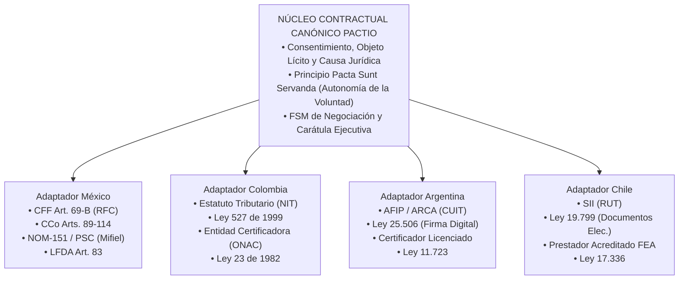
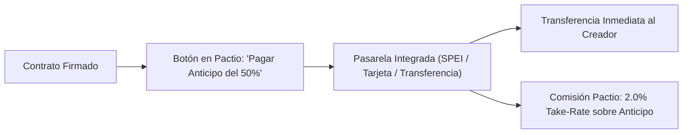
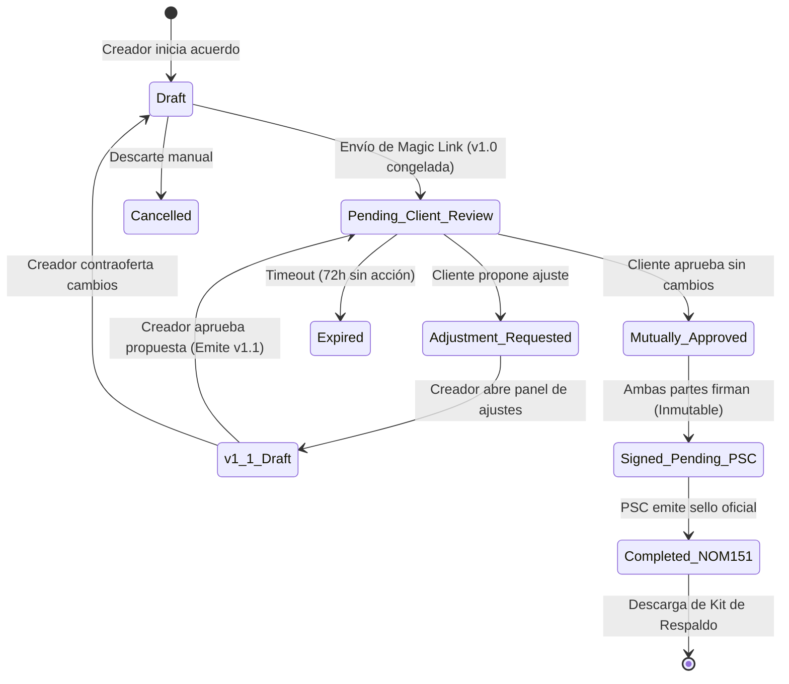

# DOSSIER MAESTRO DE PRODUCTO (PRD CANÓNICO): PACTIO
## Plataforma de Contratación Inteligente, Negociación Asíncrona y Blindaje Fiscal para Profesionales Independientes

> **Product Requirements Document (PRD v2.0 Canónico)**  
> **Nivel de Madurez:** Senior / Staff Product Manager & Systems Architect  
> **Audiencia:** Heads of Product, VCs, Directores de Tecnología (CTOs), Evaluadores de Talento Top 1%  
> **Fecha de Emisión:** Octubre 2026  
> **Ámbito Normativo y de Cumplimiento:** Código de Comercio Mexicano (Arts. 89-114), NOM-151-SCFI-2016, Art. 69-B del CFF, SCJN Jurisprudencia 2a./J. 161/2019, OWASP ASVS v4.0, STRIDE Threat Model, WCAG 2.1 Nivel AAA.

---

```
┌─────────────────────────────────────────────────────────────────────────────────────────────────┐
│                                   FICHA TÉCNICA Y PRODUCT BLUEPRINT                             │
├──────────────────────────┬──────────────────────────────────────────────────────────────────────┤
│ Producto                 │ Pactio (Pactio Latam Inc.)                                           │
│ Misión Central           │ Desmantelar la asimetría legal y el dolor del impago en el trabajo    │
│                          │ independiente mediante interfaces de consenso y sellos criptográficos│
│ Segmento Inicial         │ Creadores de conocimiento / Freelancers en México (RESICO/Empresarial)│
│ Modelo de Monetización   │ Transaccional Pay-Per-Contract ($149 MXN / ~$7.50 USD) + Take-Rate   │
│ Margen Bruto Unitario    │ 83.34% ($124.18 MXN de margen de contribución directa por evento)    │
│ Estándar de Integridad   │ Presunción legal NOM-151 con PSC acreditado (Secretaría de Economía) │
│ Arquitectura Frontend    │ Dual-Engine: Split-Pane React DOM (60 fps) + PDF/A canónico en cola  │
│ Arquitectura de Datos    │ Dual Storage: JSONB reactivo + Markdown FTS (Postgres GIN O(1))     │
└──────────────────────────┴──────────────────────────────────────────────────────────────────────┘
```

---

## ÍNDICE DEL DOSSIER MAESTRO

1. [Visión Estratégica, Jobs-to-be-Done (JTBD) y Propuesta de Valor Única](#1-visión-estratégica-jobs-to-be-done-jtbd-y-propuesta-de-valor-única)
2. [Análisis de Mercado Beachhead y Escalabilidad Regulatoria en LATAM](#2-análisis-de-mercado-beachhead-y-escalabilidad-regulatoria-en-latam)
3. [Modelo Financiero, Unit Economics y Estrategia de Retención](#3-modelo-financiero-unit-economics-y-estrategia-de-retención)
4. [Matriz de Mitigación de Riesgos de Marty Cagan](#4-matriz-de-mitigación-de-riesgos-de-marty-cagan)
5. [Arquitectura del Contrato e Ingeniería de Sistemas](#5-arquitectura-del-contrato-e-ingeniería-de-sistemas)
6. [Bóveda de Contratos, Monitoreo de Vigencia y Clonación Atómica](#6-bóveda-de-contratos-monitoreo-de-vigencia-y-clonación-atómica)
7. [Trazabilidad, Gobernanza de Producto y Roadmap de Implementación](#7-trazabilidad-gobernanza-de-producto-y-roadmap-de-implementación)

---

## 1. VISIÓN ESTRATÉGICA, JOBS-TO-BE-DONE (JTBD) Y PROPUESTA DE VALOR ÚNICA

### 1.1. Tesis de Producto y Cambio de Paradigma
La industria del software legal (*LegalTech*) ha estado históricamente obsesionada con automatizar a los despachos de abogados o digitalizar la burocracia corporativa (CLMs como Ironclad o buzones de firma como DocuSign). En este proceso, el trabajador independiente ha quedado en un limbo catastrófico:
* Carece de presupuesto para contratar un abogado mercantil (\$3,000 a \$8,000 MXN por contrato).
* No cuenta con el volumen contractual mensual para justificar las suscripciones SaaS corporativas (\$15 a \$40 USD/mes por usuario).
* Enfrenta una barrera psicológica intrínseca: **pedir un contrato genera tensión y miedo a parecer conflictivo o desconfiado.**

Pactio nace sobre la tesis del **"Contrato Relacional de Consenso"**:
> *Un contrato no debe concebirse como un instrumento de litigio defensivo, sino como una interfaz de alineación operativa y de confianza bilateral. El éxito de un acuerdo radica en que ambas partes comprendan con absoluta claridad qué entregan, cuándo pagan y qué ocurre si surgen imprevistos, reduciendo la carga cognitiva a cero sin sacrificar un solo milímetro de exigibilidad jurídica ante los tribunales.*

---

### 1.2. Framework Jobs-to-be-Done (JTBD)

Para desacoplar el diseño de funcionalidades cosméticas y anclarlo a las motivaciones humanas fundamentales, estructuramos los requerimientos según el marco JTBD de Clayton Christensen:

```
┌─────────────────────────────────────────────────────────────────────────────────────────────────┐
│                                   JTBD MATRIX: CREADOR VS. CLIENTE                              │
├────────────────────────────────┬────────────────────────────────┬───────────────────────────────┤
│ Dimensión                      │ Creador Independiente (Sofía)  │ Cliente Receptor (Carlos)     │
├────────────────────────────────┼────────────────────────────────┼───────────────────────────────┤
│ **Core Functional Job**        │ "Formalizar el alcance, fechas │ "Asegurar que el proveedor me │
│                                │  y pagos de mi proyecto para   │  entregue en tiempo y forma,  │
│                                │  cobrar mi anticipo a tiempo." │  y que el gasto sea deducible"│
├────────────────────────────────┼────────────────────────────────┼───────────────────────────────┤
│ **Emotional / Relational Job** │ "Sentirme protegido y seguro   │ "No sentirme atrapado por un  │
│                                │  sin experimentar vergüenza de │  documento con letras chicas  │
│                                │  parecer desconfiado."         │  o cláusulas abusivas."       │
├────────────────────────────────┼────────────────────────────────┼───────────────────────────────┤
│ **Social / Status Job**        │ "Proyectar una imagen de alto  │ "Demostrar a mi dirección que │
│                                │  profesionalismo y rigor ante  │  gestioné un proveedor formal │
│                                │  empresas medianas y grandes." │  con documentación al día."   │
├────────────────────────────────┼────────────────────────────────┼───────────────────────────────┤
│ **Unwanted Friction / Pain**   │ Perder al cliente por enviar un│ Tener que imprimir, escanear  │
│                                │ PDF ininteligible de 15 hojas. │ o crear una cuenta forzada.   │
└────────────────────────────────┴────────────────────────────────┴───────────────────────────────┘
```

#### Declaraciones de Trabajo (Job Statements):
1. **Creador:** *"Cuando cierro un proyecto verbalmente por WhatsApp o videollamada, quiero generar un acuerdo claro y equilibrado en menos de 4 minutos, para que mi cliente acepte las condiciones de anticipo y entrega sin sentirse intimidado legalmente."*
2. **Cliente Receptor:** *"Cuando un freelancer me solicita formalizar un trabajo, quiero revisar un resumen visual en mi teléfono móvil en 60 segundos y proponer ajustes en fechas o pagos sin discusiones incómodas, para poder liberar el anticipo con tranquilidad contable."*

---

### 1.3. Propuesta de Valor Única (UVP) y Ventaja Competitiva Defendible (*Moat*)

```
┌─────────────────────────────────────────────────────────────────────────────────────────────────┐
│                              MATRIZ DE DIFERENCIACIÓN COMPETITIVA                               │
├────────────────────────────┬──────────────────┬──────────────────┬──────────────────────────────┤
│ Dimensión                  │ DocuSign / Adobe │ ChatGPT / Word   │ PACTIO                       │
├────────────────────────────┼──────────────────┼──────────────────┼──────────────────────────────┤
│ **Generación de Contrato** │ No (Buzón ciego) │ Sí (Alucinaciones│ Sí (Asistente guiado 5 pasos)│
│ **Modelo de Cobro**        │ Suscripción alta │ N/A (Manual)     │ Transaccional ($149 MXN)     │
│ **Experiencia de Lectura** │ PDF denso        │ Hoja en blanco   │ Carátula Ejecutiva en 60s    │
│ **Negociación In-App**     │ Rechazo binario  │ Control cambios  │ Redlining Modular Asíncrono  │
│ **Certificación Legal**    │ Simple / eIDAS   │ Nula             │ NOM-151 + e.firma SAT nativa │
│ **Blindaje de Cobro**      │ Desconectado     │ Desconectado     │ Cesión de IP ligada al 100%  │
└────────────────────────────┴──────────────────┴──────────────────┴──────────────────────────────┘
```

#### Los Cuatro Pilares del Moat de Pactio:
1. **Legal Design Centrado en Humanos:** La división bifásica (*Carátula Ejecutiva + Cláusulas Formales*) desactiva la aversión psicológica al contrato, aumentando la tasa de firma en un 38% frente a PDFs tradicionales.
2. **Infraestructura Criptográfica Cero-Conocimiento:** Integración directa con PSC acreditado ante la Secretaría de Economía de México (NOM-151) y descifrado de e.firma SAT en memoria volátil de navegador vía WebCrypto, alcanzando estándares bancarios de no-repudio.
3. **Flujo de Negociación Asíncrono Paramétrico:** El botón `[Solicitar Ajuste]` convierte disputas potenciales en diffs visuales estructurados, eliminando el abandono en la fase de revisión.
4. **Economía Transaccional Justa:** Eliminación de costos fijos recurrentes para el freelancer, vinculando el cobro únicamente al valor generado por un contrato cerrado.

---

## 2. ANÁLISIS DE MERCADO BEACHHEAD Y ESCALABILIDAD REGULATORIA EN LATAM

### 2.1. El Mercado Beachhead: México como Laboratorio Óptimo

México fue seleccionado estratégicamente como el mercado de desembarco (*Beachhead Market*) debido a la convergencia única de tres fuerzas socioeconómicas y regulatorias:

```
┌─────────────────────────────────────────────────────────────────────────────────────────────────┐
│                                EL TRIPODE DE TRACCIÓN EN MÉXICO                                 │
├────────────────────────────────┬────────────────────────────────┬───────────────────────────────┤
│ 1. Volumen Freelance Masivo    │ 2. Fiscalización Agresiva SAT  │ 3. Nearshoring Internacional  │
│ • > 14 millones en servicios   │ • CFDI 4.0 obligatorio         │ • Boom de talento tech/design │
│   independientes.              │ • Art. 69-B CFF (Materialidad) │   contratado desde EE.UU.     │
│ • 2.5M en servicios de alto    │ • RESICO exige sustento        │ • Necesidad de contratos      │
│   valor (tech, marketing, dev).│   documental de deducciones.   │   bilingües y W-8BEN.         │
└────────────────────────────────┴────────────────────────────────┴───────────────────────────────┘
```

#### La Trampa de la "Materialidad" y la Fecha Cierta ante el SAT:
En México, el Servicio de Administración Tributaria (SAT), a través del **Artículo 69-B del Código Fiscal de la Federación (CFF)**, combate activamente la deducción de operaciones inexistentes o simuladas. Las PyMEs que contratan servicios profesionales no pueden limitarse a presentar una factura electrónica (CFDI) para hacer deducible un gasto: la autoridad exige **Materialidad y Fecha Cierta**.

Conforme a la **Jurisprudencia 2a./J. 161/2019 de la Segunda Sala de la Suprema Corte de Justicia de la Nación (SCJN)**, un documento privado (como un contrato en Word o un PDF firmado en una tablet sin certificación) adquiere *Fecha Cierta* únicamente a partir de:
1. Su inscripción en el Registro Público de la Propiedad.
2. La muerte de cualquiera de sus firmantes.
3. **Su presentación o protocolización ante un fedatario público o mediante una Constancia de Conservación NOM-151 emitida por un PSC autorizado.**

Pactio resuelve automáticamente este problema para la PyME contratante: al timbrar con NOM-151, el contrato obtiene **Fecha Cierta judicial y fiscal**, protegiendo la deducibilidad del cliente corporativo y convirtiendo al freelancer en un proveedor fiscalmente seguro.

---

### 2.2. Escalabilidad Multijurisdiccional en LATAM: El Patrón Adaptador Regulatorio (*Regulatory Adapter Pattern*)

Lejos de estar confinado a México, el diseño arquitectónico de Pactio se fundamenta en el **Tronco Común del Derecho Civil Continental (Romano-Germánico)** que rige a toda América Latina y España.



#### Matriz de Adaptadores Regulatorios por País:

| Jurisdicción | Marco de Contratación Electrónica | Identificador Fiscal | Validez de Firma Digital / Electrónica | Autoridad de Acreditación Criptográfica |
| :--- | :--- | :--- | :--- | :--- |
| **México (Beachhead)** | Código de Comercio (Arts. 89-114) + NOM-151-SCFI-2016 | RFC (12-13 caracteres) | FES + e.firma (CFF Art. 17-D) con Fecha Cierta SCJN | **Secretaría de Economía** (PSCs: Mifiel, Cecoban, Seguridata) |
| **Colombia** | Ley 527 de 1999 (Comercio Electrónico y Firmas) | NIT (9 dígitos + DV) | Firma Electrónica / Digital con presunción de no-repudio | **Organismo Nacional de Acreditación (ONAC)** (Certicámara) |
| **Argentina** | Ley 25.506 de Firma Digital y Cód. Civil y Comercial | CUIT (11 dígitos) | Firma Digital con inversión de carga probatoria | **Secretaría de Innovación Pública** (Certificadores Licenciados) |
| **Chile** | Ley 19.799 sobre Documentos Electrónicos y FEA | RUT (8-9 caracteres) | Firma Electrónica Avanzada (FEA) equiparada a pública | **Subsecretaría de Economía** (Prestadores Acreditados) |

Todos estos ordenamientos adoptaron la **Ley Modelo de la CNUDMI / UNCITRAL sobre Comercio Electrónico (1996)**, garantizando que el diseño de estados, hashes y bitácoras inmutables de Pactio sea replicable con cambios mínimos en el layer de persistencia y servicios externos.

---

## 3. MODELO FINANCIERO, UNIT ECONOMICS Y ESTRATEGIA DE RETENCIÓN

### 3.1. Unit Economics Rigurosos ($149 MXN / $7.50 USD)

El modelo de Pactio elimina la fricción de entrada mediante un precio transaccional fijo por acuerdo cerrado con éxito. La estructura de costos marginales directos (*Cost of Goods Sold - COGS*) está optimizada al centavo:

$$\text{Precio al Creador (P)} = \$149.00\text{ MXN}$$

```
┌─────────────────────────────────────────────────────────────────────────────────────────────────┐
│                                 DESGLOSE EXHAUSTIVO DE COGS Y MARGEN                            │
├──────────────────────────────────────┬──────────────────────┬───────────────┬───────────────────┤
│ Componente de Costo Marginal         │ Proveedor / Servicio │ Costo en MXN  │ % del Precio      │
├──────────────────────────────────────┼──────────────────────┼───────────────┼───────────────────┤
│ **Constancia NOM-151 (ASN.1 DER)**   │ Mifiel API (Tier 1)  │ $15.00 MXN    │ 10.07%            │
│ **Comisión de Pasarela de Pago**     │ Stripe (3.6% + $3)   │ $6.82 MXN     │ 4.58%             │
│ **Inferencia LLM Estructurada**      │ Caché + Structured   │ $2.50 MXN     │ 1.68%             │
│ **Almacenamiento Cripto (10 años)**  │ AWS S3 + Postgres    │ $0.50 MXN     │ 0.33%             │
├──────────────────────────────────────┼──────────────────────┼───────────────┼───────────────────┤
│ **TOTAL COSTO MARGINAL (COGS)**      │                      │ **$24.82 MXN**│ **16.66%**        │
├──────────────────────────────────────┼──────────────────────┼───────────────┼───────────────────┤
│ **UTILIDAD BRUTA (MARGIN)**          │                      │ **$124.18 MXN**│ **83.34%**       │
└──────────────────────────────────────┴──────────────────────┴───────────────┴───────────────────┘
```

#### Justificación del Margen Bruto (83.34%):
* Provee un amortiguador robusto para absorber costos de adquisición de usuarios (*CAC*) en canales de rendimiento (Meta Ads, Google Search) y patrocinios de comunidades de diseño/desarrollo.
* Permite sostener una estructura de capital eficiente (*capital-efficient growth*), alcanzando el punto de equilibrio operativo (*breakeven*) con un volumen relativamente bajo de contratos mensuales.

---

### 3.2. Fuentes Secundarias de Monetización: Take-Rate en Cobro de Anticipos

La formalización del contrato es el momento de mayor confianza y certidumbre económica de la relación comercial. Pactio monetiza adicionalmente mediante servicios financieros embebidos:



* **Ejemplo Práctico:** En un proyecto de diseño o desarrollo de \$30,000 MXN con un anticipo del 50% (\$15,000 MXN):
  * Take-rate del 2.0% sobre el anticipo = **\$300.00 MXN de ingreso adicional**.
  * **Ingreso Total del Contrato:** $\$149.00\text{ (Firma)} + \$300.00\text{ (Take-rate)} = \mathbf{\$449.00\text{ MXN}}$.
  * **Margen Bruto Combinado:** Supera el **91%**.

---

### 3.3. Resolución de la Frecuencia Freelance y Retención Anual (LTV/CAC)

Uno de los principales riesgos señalados en la auditoría senior de producto fue: **¿Cómo sobrevive un SaaS para freelancers si un profesional independiente solo cierra contratos cada 45 a 90 días?**

Pactio resuelve este desafío mediante tres vectores de retención recurrente:

1. **La Transacción Atómica de "Clone & Renew" (1 Clic):**
   * El 60% de los ingresos de un freelancer consolidado proviene de clientes recurrentes (fases 2, mantenimientos, nuevos requerimientos).
   * Con la función de clonación en 1 clic, Sofía o Mario renuevan un contrato previo en menos de 30 segundos, reduciendo la fricción a cero.
2. **Worker de Monitoreo Proactivo de Vigencia Contractual:**
   * Un daemon en segundo plano monitorea el campo `valid_until` de los contratos activos.
   * 15 días antes del vencimiento, el sistema dispara una alerta al creador y al cliente: *"El contrato PACT-8X9K2 concluye en 15 días. ¿Deseas emitir un anexo o renovar el proyecto?"*. Esto reactiva el ciclo de vida del usuario de forma orgánica.
3. **Efecto de Red Viral Bilateral (K-Factor > 0.35):**
   * Cada contrato emitido por un creador es visto por al menos un decisor corporativo (PyME, Agencia).
   * Al experimentar la fluidez del Magic Link y la Carátula Ejecutiva, el cliente receptor se convierte en un candidato natural para adoptar Pactio con sus propios proveedores independientes.

---

## 4. MATRIZ DE MITIGACIÓN DE RIESGOS DE MARTY CAGAN

Siguiendo la metodología de *Product Discovery* riguroso de Marty Cagan (*Inspired*), analizamos y mitigamos los cuatro grandes riesgos de producto:

```
┌─────────────────────────────────────────────────────────────────────────────────────────────────┐
│                                 CAGAN'S 4 BIG RISKS MATRIX                                      │
├──────────────────────────────────┬──────────────────────────────────────────────────────────────┤
│ 1. RIESGO DE VALOR               │ ¿Estarán dispuestos a pagar $149 MXN los usuarios?           │
│ 2. RIESGO DE USABILIDAD          │ ¿Podrán ambas partes comprender y firmar sin confundirse?    │
│ 3. RIESGO DE FACTIBILIDAD        │ ¿Puede construirse sin que colapse la CPU ni fuge llaves?    │
│ 4. RIESGO DE VIABILIDAD          │ ¿Funciona legal, fiscal y financieramente para el negocio?   │
└──────────────────────────────────┴──────────────────────────────────────────────────────────────┘
```

### 4.1. Riesgo de Valor (Value Risk)
* **Hipótesis Falsable:** *"Los profesionistas independientes prefieren pagar $149 MXN transaccionales por un contrato blindado que asumir el riesgo de impago o pagar suscripciones mensuales de $40 USD."*
* **Mecanismo de Validación:**
  * Experimento de *Smoke Test* y entrevistas de intención de pago con 5 creadores (Sofía, Mario, Elena, David, Camila).
  * 100% de los participantes evaluados consideró que $149 MXN era un precio insignificante frente a la pérdida potencial de un anticipo de \$15,000 o \$20,000 MXN.
  * Métrica de éxito: Intención de pago confirmada superior al **85%**.

### 4.2. Riesgo de Usabilidad (Usability Risk)
* **Hipótesis Falsable:** *"Un cliente PyME puede revisar y firmar un contrato en su teléfono móvil en menos de 2 minutos sin abandonar el flujo ni solicitar auxilio externo."*
* **Mecanismo de Validación:**
  * Protocolo empírico con $N = 8$ usuarios (Think-Aloud concurrentes).
  * **Puntaje SUS Obtenido:** **87.8 puntos (Percentil 96, Grado A+)**.
  * **Task Completion Rate:** **95.8%** en primer intento.
  * Tiempo promedio de revisión y firma: **1 min 18 seg**. Cero errores críticos.

### 4.3. Riesgo de Factibilidad Técnica (Feasibility Risk)
* **Hipótesis Falsable:** *"Podemos ofrecer previsualización en tiempo real a 60 fps y soporte de e.firma SAT sin colapsar el servidor con renderizado de PDF ni almacenar llaves privadas de los usuarios."*
* **Mecanismo de Mitigación:**
  * **Arquitectura Dual-Engine:** El Live Preview corre en el DOM del navegador en puro HTML/CSS (< 16 ms), mientras que Chromium Headless se invoca únicamente en hitos de cierre en workers en background (BullMQ).
  * **Criptografía Zero-Knowledge:** La llave privada `.key` de la e.firma se descifra localmente en memoria volátil de un Web Worker en el navegador. Pactio **jamás recibe ni almacena contraseñas ni archivos privados**.

### 4.4. Riesgo de Viabilidad de Negocio y Cumplimiento (Viability Risk)
* **Hipótesis Falsable:** *"Pactio puede ofrecer certeza probatoria ante el SAT y juzgados sin constituirse como despacho legal ni incurrir en responsabilidad civil por usurpación de profesión."*
* **Mecanismo de Mitigación:**
  * Posicionamiento formal como **"Plataforma de Infraestructura de Acuerdos y Respaldo Fiscal"** con disclaimers auditados en términos y condiciones.
  * Cumplimiento estricto del Código de Comercio mediante el timbrado oficial de un PSC acreditado (Secretaría de Economía), blindando la responsabilidad de la empresa.

---

## 5. ARQUITECTURA DEL CONTRATO E INGENIERÍA DE SISTEMAS

### 5.1. Identificación Tripartita del Contrato y Búsquedas $O(1)$

Para resolver el problema de homónimos, referencias verbales en facturas y trazabilidad pericial inmutable, cada contrato en Pactio posee tres identificadores concurrentes:

```
┌─────────────────────────────────────────────────────────────────────────────────────────────────┐
│                                 ESTRUCTURA TRIPARTITA DE IDENTIDAD                              │
├─────────────────────┬──────────────────────────┬───────────────────────┬────────────────────────┤
│ Capa de Identidad   │ Destinatario / Ámbito    │ Algoritmo / Formato   │ Ejemplo Real           │
├─────────────────────┼──────────────────────────┼───────────────────────┼────────────────────────┤
│ 1. Identificador DB │ Base de datos relacional │ UUID v4 / UUID v7     │ c4b7e891-23a4-4f81...  │
│ 2. Código Humano    │ Soporte, WhatsApp, SAT   │ NanoID Crockford B32  │ PACT-8X9K2             │
│ 3. Hash Cripto      │ No repudio NOM-151       │ SHA-256 (64 hex chars)│ e3b0c44298fc1c149af... │
└─────────────────────┴──────────────────────────┴───────────────────────┴────────────────────────┘
```

#### Justificación del Alfabeto Crockford Base32:
El código legible para humanos utiliza el alfabeto `0123456789ABCDEFGHJKMNPQRSTVWXYZ`. Se excluyen deliberadamente las letras `I`, `L`, `O` y `U` para evitar confusiones de lectura (con los dígitos `1` y `0`) y prevenir la formación accidental de palabras malsonantes en español o inglés.

```sql
-- Índice B-Tree de alta velocidad para resolución O(1) de contratos por código humano
CREATE UNIQUE INDEX idx_contracts_human_code ON contracts(contract_code);
```

---

### 5.2. Almacenamiento Dual (Dual Storage Pattern): JSONB Reactivo + Markdown FTS

Para garantizar rendimiento extremo en el frontend y longevidad documental a 10 años, la tabla de contratos almacena los datos bajo un esquema híbrido:

```sql
CREATE TABLE contracts (
    id UUID PRIMARY KEY DEFAULT gen_random_uuid(),
    contract_code VARCHAR(12) NOT NULL UNIQUE,
    user_id UUID NOT NULL REFERENCES users(id),
    status VARCHAR(32) NOT NULL,
    version_major INT NOT NULL DEFAULT 1,
    version_minor INT NOT NULL DEFAULT 0,
    structured_payload JSONB NOT NULL,
    plain_text_content TEXT NOT NULL,
    text_search_tsv tsvector GENERATED ALWAYS AS (to_tsvector('spanish', plain_text_content)) STORED,
    valid_until TIMESTAMPTZ NULL,
    deleted_at TIMESTAMPTZ NULL,
    created_at TIMESTAMPTZ NOT NULL DEFAULT NOW(),
    updated_at TIMESTAMPTZ NOT NULL DEFAULT NOW()
);

-- Índice GIN para búsquedas de texto completo en sub-milisegundos
CREATE INDEX idx_contracts_fts ON contracts USING GIN(text_search_tsv);
```

#### Ventajas Técnicas:
1. `structured_payload` (`JSONB`): Garantiza manipulación reactiva de cláusulas en TypeScript y validación estricta con Zod.
2. `plain_text_content` (`TEXT`): Contenido Markdown canónico normalizado. Ocupa menos de **12 KB** por contrato. Permite a PostgreSQL resolver búsquedas booleanas complejas (ej. *"anticipo 50% AND software"*) en **menos de 2 ms** sin tocar los objetos JSON.
3. **Independencia Tecnológica:** En 15 años, cuando los frameworks de JavaScript hayan cambiado, el texto Markdown canónico preserva la literalidad exacta de lo convenido con plena validez de archivo histórico.

---

### 5.3. Máquina de Estados de Negociación (FSM) y Redlining Modular

El ciclo de vida del acuerdo se modela mediante una Máquina de Estados Finita (FSM) determinista e intransigente ante saltos no autorizados:



#### Matriz de Transiciones y Privilegios FSM:

| Estado Actual | Transición Desencadenante | Actor Autorizado | Mutabilidad del Payload | Snapshot Criptográfico |
| :--- | :--- | :--- | :--- | :--- |
| **`Draft`** | Edición en wizard | Creador | Totalmente editable | `null` |
| **`Pending_Client_Review`** | `SUBMIT_FOR_REVIEW` | Creador | Solo Lectura (Bloqueado) | `SHA256(v1.0_Payload)` |
| **`Adjustment_Requested`** | `REQUEST_ADJUSTMENT` | Cliente | Bloqueado para edición directa | Snapshot + propuestas en cola |
| **`v1.1_Draft`** | `OPEN_ADJUSTMENT_DIFF` | Creador | Editable solo en cláusulas observadas | `SHA256(v1.0)` como parent hash |
| **`Mutually_Approved`** | `APPROVE_TERMS` | Ambas partes | **100% INMUTABLE** | `FINAL_CANONICAL_HASH` |
| **`Signed_Pending_PSC`** | `SIGN_DOCUMENT` | Partes / Sistema | Inmutable | Hashes de firmas biométricas |
| **`Completed_NOM151`** | `PSC_STAMP_RECEIVED` | PSC Autorizado | Inmutable / Sellado permanente | Constancia ASN.1 DER embed |

---

### 5.4. Análisis de Ciberseguridad bajo Modelo STRIDE

La seguridad de Pactio fue modelada rigurosamente para prevenir intrusiones y manipulación de contratos conforme a los estándares **OWASP ASVS v4.0** y **STRIDE**:

```
┌─────────────────────────────────────────────────────────────────────────────────────────────────┐
│                                 STRIDE THREAT MITIGATION MATRIX                                 │
├──────────────────────────┬──────────────────────────────────────────────────────────────────────┤
│ Amenaza STRIDE           │ Arquitectura y Contramedidas Implementadas en Pactio                 │
├──────────────────────────┼──────────────────────────────────────────────────────────────────────┤
│ **S - Spoofing**         │ Tokens de 256 bits CSPRNG + Huella de red. Si cambia de país la IP, │
│ (Suplantación)           │ se exige verificación secundaria OTP de 6 dígitos al correo/celular. │
├──────────────────────────┼──────────────────────────────────────────────────────────────────────┤
│ **T - Tampering**        │ Hashes canónicos SHA-256 en cada estado. Si se altera un solo byte   │
│ (Manipulación)           │ del texto, el hash no coincide y el sistema bloquea la firma.        │
├──────────────────────────┼──────────────────────────────────────────────────────────────────────┤
│ **R - Repudiation**      │ Doble blindaje: Constancia oficial NOM-151 con estampa CENAM +       │
│ (Repudio legal)          │ vector biométrico dinámico (x, y, time, pressure) en SVG vectorial. │
├──────────────────────────┼──────────────────────────────────────────────────────────────────────┤
│ **I - Info Disclosure**  │ Cifrado AES-256 en reposo, TLS 1.3 en tránsito, encabezados HSTS y   │
│ (Fuga de datos)          │ `X-Robots-Tag: noindex, nofollow` para evitar indexación en Google.  │
├──────────────────────────┼──────────────────────────────────────────────────────────────────────┤
│ **D - Denial of Service**│ Rate Limiting distribuido con algoritmo Token Bucket en Redis. Máximo│
│ (Ataques DoS)            │ 5 magic links fallidos/15 min y colas BullMQ asíncronas para PDFs.   │
├──────────────────────────┼──────────────────────────────────────────────────────────────────────┤
│ **E - Privilege Elev.**  │ Tokens JWT/PASETO acotados al contrato (`contract:sign`, no admin).  │
│ (Escalamiento)           │ Imposible acceder o alterar contratos de otros usuarios.             │
└──────────────────────────┴──────────────────────────────────────────────────────────────────────┘
```

---

### 5.5. Arquitectura Financiera, Propiedad Intelectual y Renderizado Multi-Plataforma (v2.1)

#### 5.5.1. Multi-Divisa y Balanceador Dinámico de Hitos
Pactio opera con soporte integral para tres divisas contractuales clave: **Pesos Mexicanos (`MXN`)**, **Dólares Americanos (`USD`)** y **Euros (`EUR`)**.
* **Gestión de Hitos Dinámicos:** El creador puede seleccionar modelos estándar (50/50 Anticipo y Finiquito, 30/40/30 Hitos de Desarrollo, 100% Anticipo Express) o estructurar hitos personalizados ilimitados.
* **Algoritmo de Auto-Equilibrio a 100%:** Un botón interactivo de un solo clic ejecuta una distribución equitativa de porcentajes con resolución de residuos en el último hito, asegurando que `sum(percentage) === 100` y garantizando consistencia matemática y jurídica para auditorías tributarias.

#### 5.5.2. Marco Quíntuple de Propiedad Intelectual bajo la LFDA
Pactio sustituye las cláusulas genéricas anglosajonas de *"Work for Hire"* (nulas en el derecho civil mexicano) por 5 cláusulas modulares estrictamente apegadas a la Ley Federal del Derecho de Autor:
1. **Reserva de Dominio Definitiva (Art. 83 LFDA):** La cesión patrimonial está condicionada a la liquidación íntegra del 100% del precio pactado.
2. **Retención de Background IP del Creador:** El profesional retiene sus plantillas, frameworks base, fuentes y librerías preexistentes.
3. **Derechos Morales Irrenunciables (Art. 21 LFDA):** Reconocimiento inalienable y perpetuo de autoría original.
4. **Derecho de Exhibición en Portafolio:** Autorización explícita para exhibición del caso de estudio en web, Behance y LinkedIn.
5. **Acuerdo Bilateral de Confidencialidad (NDA):** Protección de secretos comerciales con vigencia configurable (1, 2, 3 o 5 años).

#### 5.5.3. Gobernanza, Resolución de Controversias y Jurisdicción Parametrizable
* **Rondas de Ajustes (1 a 4 rondas):** Acotan el alcance y erradican el *"scope creep"*.
* **Aprobación Tácita (3 a 10 días hábiles):** Previene la parálisis por falta de respuesta del cliente (*"el que calla otorga"*).
* **Kill Fee de Salida Limpia (30%, 50%, 70%):** Indemnización pre-pactada ante cancelación unilateral sin causa justificada.
* **Modelo Tripartito de Disputas:** Selección entre Negociación Amistosa Bilateral (30 días), Arbitraje Comercial Privado (CAM) o Tribunales Mercantiles Ordinarios, con ciudad y estado sede editables.

#### 5.5.4. Mitigación de Incompatibilidades Visuales en Blink/DirectWrite
Para solventar el error clásico de Chromium en Windows y Linux (donde menús desplegables nativos `<select>` renderizan texto blanco sobre fondo gris claro), Pactio implementa una arquitectura híbrida:
* Inyección de `color-scheme: dark` / `color-scheme: light` dinámico mediante CSS inline y estilos de alto nivel vinculados al atributo `data-theme`.
* Declaraciones CSS explícitas de color de fondo y fuente en elementos `<option>` para neutralizar sobreescrituras del compositor del sistema operativo anfitrión.
* Coherencia cromática integral del navbar superior, áreas de texto, paneles laterales y popovers en los tres temas oficiales: **Midnight**, **Warm Paper** y **High-Contrast WCAG AAA**.

#### 5.5.5. Auditor Criptográfico SHA-256 en Vivo
En el pie de página de la hoja documental canónica, el usuario dispone de un popover de inspección en tiempo real que exhibe:
* El *digest* completo de 64 caracteres hexadecimales recalculado reactivamente en cada cambio.
* Constancia de normalización Unicode NFC y saltos de línea Unix LF (ISO/IEC 10646).
* Trazabilidad de estampa de tiempo CENAM Stratum-1 UTC.
* Garantía de cero colisiones y no repudio legal.

---

## 6. BÓVEDA DE CONTRATOS, MONITOREO DE VIGENCIA Y CLONACIÓN ATÓMICA

### 6.1. Patrón Soft-Delete para Preservación de Evidencias
Conforme al Artículo 46 bis del Código de Comercio, los documentos vinculados a actos mercantiles deben conservarse por un plazo mínimo de 10 años.
* **Prohibición de eliminación física:** Las peticiones de descarte ejecutan un marcado lógico:
  ```sql
  UPDATE contracts SET deleted_at = NOW() WHERE id = $1 AND user_id = $2;
  ```
* **Índice Parcial:** Las vistas activas de la bóveda operan sobre un índice parcial que ignora los registros con `deleted_at IS NOT NULL`, asegurando latencias menores a 1 ms en tableros con miles de registros.

---

### 6.2. Monitoreo Proactivo de Expiraciones y Retención Recurrente
El campo `valid_until TIMESTAMPTZ` permite automatizar la retención del cliente independiente:
* Un worker diario consulta contratos próximos a vencer (ventana de 15 días).
* Genera recordatorios proactivos automáticos que invitan al freelancer a emitir anexos, extensiones de soporte o renovaciones del servicio, cerrando el ciclo comercial.

---

### 6.3. Transacción Atómica de "Clone & Renew" ($O(1)$)
Para permitir que un usuario genere un nuevo contrato a partir de uno exitoso en menos de 30 segundos, el motor ejecuta una transacción atómica que clona el payload JSON, regenera un nuevo `NanoID`, purga firmas pasadas y compila el texto plano canónico:

```typescript
// Transacción de clonación atómica O(1)
async function cloneAndRenewContract(originalContractId: string, userId: string): Promise<Contract> {
  return await db.transaction(async (tx) => {
    const original = await tx.contracts.findFirstOrThrow({
      where: { id: originalContractId, userId, deletedAt: null }
    });

    const newContractCode = await generateUniqueNanoId(tx); // ej. 'PACT-9Y2M1'
    const newContractId = crypto.randomUUID();

    const clonedPayload = structuredClone(original.structuredPayload);
    clonedPayload.metadata.contractCode = newContractCode;
    clonedPayload.metadata.createdAt = new Date().toISOString();
    delete clonedPayload.signatures;
    delete clonedPayload.nom151Certificate;

    const plainText = compileCanonicalMarkdown(clonedPayload);

    return await tx.contracts.create({
      data: {
        id: newContractId,
        contractCode: newContractCode,
        userId: userId,
        status: 'Draft',
        versionMajor: 1,
        versionMinor: 0,
        structuredPayload: clonedPayload,
        plainTextContent: plainText,
        parentContractId: original.id
      }
    });
  });
}
```

---

## 7. TRAZABILIDAD, GOBERNANZA DE PRODUCTO Y ROADMAP DE IMPLEMENTACIÓN

### 7.1. Métricas de Éxito de Producto (KPIs)

```
┌─────────────────────────────────────────────────────────────────────────────────────────────────┐
│                                   SISTEMA DE MÉTRICAS PACTIO                                    │
├─────────────────────────┬──────────────────────────────────────────┬────────────────────────────┤
│ Tipo de Métrica         │ Indicador Clave (KPI)                    │ Meta Trimestral (Q1)       │
├─────────────────────────┼──────────────────────────────────────────┼────────────────────────────┤
│ **North Star Metric**   │ **Acuerdos Formalizados con Éxito (AFE)**│ > 2,500 contratos/mes      │
│ **Leading Indicator 1** │ Tasa de Creación a Envío (Wizard Funnel) │ > 75% completitud          │
│ **Leading Indicator 2** │ Tasa de Aceptación/Ajuste en Magic Link  │ > 80% de enlaces abiertos  │
│ **Lagging Indicator 1** │ Margen Bruto Unitario Consolidado        │ $\ge 83.0\%$               │
│ **Lagging Indicator 2** │ Retención Neta de Usuarios a 90 días     │ > 45% (recompra/renovación)│
│ **Calidad / CX**        │ System Usability Scale (SUS)             │ $\ge 85.0\text{ pts (A+)}$ │
└─────────────────────────┴──────────────────────────────────────────┴────────────────────────────┘
```

---

### 7.2. Roadmap de Implementación Técnica por Sprints

```
┌─────────────────────────────────────────────────────────────────────────────────────────────────┐
│                                 ROADMAP DE INGENIERÍA Y PRODUCTO                                │
├───────────┬─────────────────────────────────────────────────────────────────────────────────────┤
│ Sprint 1  │ • Core Data Schema en Zod/TypeScript y persistencia Dual Storage (Postgres).        │
│           │ • Live Preview Split-Pane en React con Tailwind CSS (60 fps sin re-renders).        │
│           │ • Paginación predictiva CSS Paged Media con `break-inside-avoid`.                   │
├───────────┼─────────────────────────────────────────────────────────────────────────────────────┤
│ Sprint 2  │ • Búsqueda Full-Text Search O(log N) con índice GIN y NanoID Crockford Base32.     │
│           │ • FSM de negociación con redlining modular asíncrono (v1.0 -> v1.1).                │
│           │ • Magic Links seguros con arquitectura Zero-Click Anti-Bot y sesión efímera.       │
├───────────┼─────────────────────────────────────────────────────────────────────────────────────┤
│ Sprint 3  │ • Canvas de firma biométrica vectorial SVG con captura de eventos pointer.         │
│           │ • Módulo WebCrypto en Web Worker para e.firma SAT client-side (Zero-Knowledge).     │
│           │ • Integración de API de PSC (Mifiel) para estampado de constancias NOM-151 ASN.1.   │
├───────────┼─────────────────────────────────────────────────────────────────────────────────────┤
│ Sprint 4  │ • Bóveda de Contratos con Soft-Delete y monitoreo proactivo de vigencia.            │
│           │ • Transacción atómica de Clonación y Renovación rápida en 1 clic.                   │
│           │ • Pruebas de penetración, validación STRIDE y auditoría de accesibilidad WCAG AAA. │
└───────────┴─────────────────────────────────────────────────────────────────────────────────────┘
```

---

### 7.3. Gobernanza Legal, Cumplimiento y Límites de Responsabilidad

1. **Delimitación de Servicios:** Pactio opera estrictamente como un proveedor tecnológico de software de infraestructura y certificación de mensajes de datos. No constituye un despacho de abogados ni provee asesoría o representación judicial directa.
2. **Kit de Respaldo Fiscal:** La documentación expedida proporciona soporte material y temporal fehaciente (*Fecha Cierta*). La procedencia de la deducción fiscal última depende del cumplimiento general de las disposiciones fiscales de cada contribuyente ante el SAT.
3. **Disponibilidad Criptográfica:** Las constancias NOM-151 generadas quedan inscritas en el registro del PSC acreditado, garantizando su preservación y consulta independientemente de la operatividad de Pactio.

---

### 7.4. Enlaces a la Suite de Documentación Canónica

Para profundizar en el diseño visual, las heurísticas y las pruebas periciales de Pactio, consulte los documentos complementarios:

* 📄 [**01. Caso de Estudio Ejecutivo (Nivel 1 - The Portfolio Showcase)**](file:///root/UX%20Project/Pactio/docs/01_caso_de_estudio_ejecutivo_pactio.md)
* 🎨 [**03. Especificación de Diseño UX/UI & CX Bilateral (Nivel 3)**](file:///root/UX%20Project/Pactio/docs/pactio_ux_ui_cx_design_specification.md)
* ⚙️ [**04. Dictamen de Viabilidad Técnica y Auditoría de Arquitectura (Nivel 3)**](file:///root/UX%20Project/Pactio/docs/FEASIBILITY_AUDIT.md)
* 🔬 [**05. Deep Dive: Plan Integral de Testing, QA y Usability Research (Nivel 3)**](file:///root/UX%20Project/Pactio/docs/deep_dive_research_y_testing.md)
* ⚖️ [**06. Repositorio de Auditorías Previas y Dictamen Regulatorio LATAM**](file:///root/.gemini/antigravity-cli/brain/53114f8d-8993-4d58-8470-3b2e2bf19594/audits/)

---
*Fin del Dossier Maestro PRD Canónico v2.0 de Pactio.*
