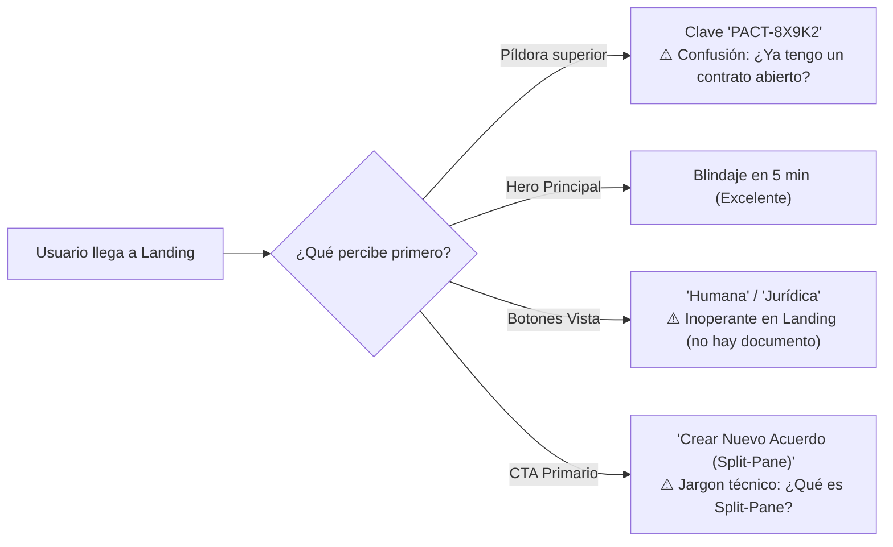
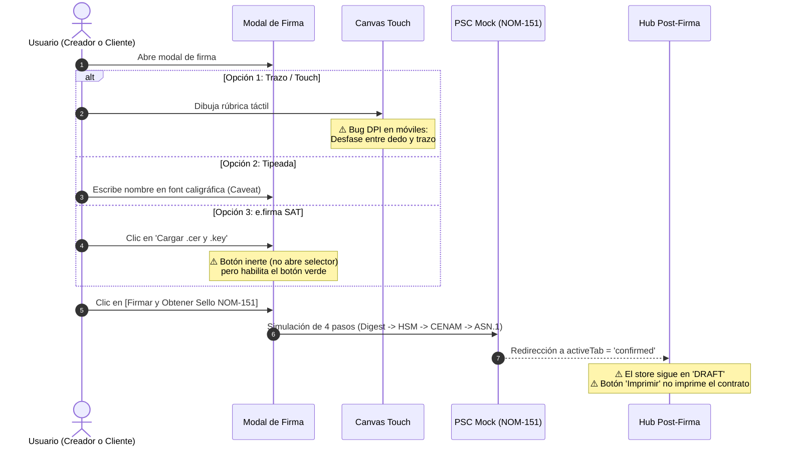

# Auditoría Exploratoria de Usabilidad UX & Visual (Black-Box / Naive User Auditor)
**Proyecto:** Pactio · Acuerdos Digitales Transparentes (NOM-151-SCFI-2016 & LFDA)  
**Evaluador:** Tester Exploratorio e Investigador de UX (Naive / First-Time User Auditor)  
**Fecha de Auditoría:** 29 de Octubre de 2026  
**Entorno de Pruebas:** Linux x86_64 · Node 22 · Vite Dev Server (Port 3001) · React 19 · Vitest  
**Documento Destino:** `/root/.gemini/antigravity-cli/brain/53114f8d-8993-4d58-8470-3b2e2bf19594/audits/naive_user_exploratory_audit.md`

---

## 1. Resumen Ejecutivo y Metodología Black-Box

Esta auditoría fue ejecutada adoptando la perspectiva estricta de un **usuario primerizo externo (*naive user*)**, alternando entre dos arquetipos fundamentales:
1. **Sofía (Creadora / Freelancer):** Diseñadora UX que necesita formalizar un acuerdo de $30,000 MXN en minutos sin parecer desconfiada ni intimidar a su cliente.
2. **Mario / Carlos (Cliente Receptor):** Director de operaciones o dueño de PyME que recibe un enlace por WhatsApp/correo, espera claridad absoluta, desconfía de la jerga jurídica y desea revisar entregables, costos y tiempos desde su navegador o teléfono sin registrarse.

### Diagnóstico Global
| Dimensión Evaluada | Calificación (1-10) | Diagnóstico Sintético |
| :--- | :---: | :--- |
| **Claridad Narrativa & Legal Design** | **9.2 / 10** | Excelente propuesta de valor. La "Vista Humana" traduce con maestría conceptos complejos (anticipo, LFDA Art. 83, silencio tácito). |
| **Ergonomía Visual & Temas** | **8.5 / 10** | La paleta de colores y las fuentes (*Newsreader*, *Plus Jakarta Sans*, *Caveat*) evocan rigor editorial y confianza. Pequeños desajustes en Alto Contraste. |
| **Fidelidad WYSIWYG ("Lo que ves es lo que firmas")** | **5.5 / 10** | **Fricción Crítica:** La vista jurídica del Split-Pane solo muestra 4 cláusulas de forma estática en JSX, mientras que el compilador Markdown real genera 9 cláusulas completas. |
| **Integridad del Flujo Post-Firma y Estados** | **6.0 / 10** | Tras el timbrado NOM-151, la Bóveda sigue mostrando el contrato como "Borrador Activo" porque la FSM no se actualiza en el store. |
| **Accesibilidad Universal (A11y)** | **6.8 / 10** | El escalador tipográfico (A- / A+) es inoperante para el 95% de la interfaz por colisión entre unidades `rem` de Tailwind y un contenedor `div`. |
| **Eficiencia de Arquitectura & Código** | **5.0 / 10** | Archivo monolítico `src/App.tsx` de 2,125 líneas. Doble compilación Markdown y cálculo SHA-256 síncrono en cada pulsación de tecla. |

---

## 2. Auditoría Detallada por Flujo de Usuario

### 2.1. Landing Page & Onboarding Inicial



#### Hallazgos y Fricciones Observadas:
1. **Píldora NanoID Pre-Inicializada en la Cabecera:**
   - *Comportamiento*: Al ingresar a la Landing (`activeTab === 'landing'`), la barra de navegación superior muestra permanentemente `Clave única: PACT-8X9K2` con botón de copia.
   - *Impacto en Naive User*: Desconcierto. El usuario se pregunta si está en una sesión privada ajena o si ya se creó un contrato sin su consentimiento.
   - *Causa Técnica*: `contractCode` se renderiza incondicionalmente en el `<header>` (líneas 341-353 de `App.tsx`), independientemente de si el usuario está en el creador o en la página de inicio.
2. **Conmutador de Vista "Humana / Jurídica" Inoperante en Landing:**
   - *Comportamiento*: Los botones de lenguaje dual están habilitados en la cabecera durante la Landing. Al hacer clic, el botón cambia de color pero nada en la pantalla reacciona.
   - *Impacto en Naive User*: Sensación de botón "roto" o "fantasma".
   - *Causa Técnica*: El estado `previewMode` solo tiene efecto cuando se renderiza el documento contractual en `creator` o `client-review`.
3. **Jerga Técnica en los Botones de Acción:**
   - *Comportamiento*: El botón principal y la pestaña dicen `"Creador (Split-Pane)"` y `"Crear Nuevo Acuerdo (Split-Pane)"`.
   - *Impacto en Naive User*: "Split-Pane" es un término de desarrollo frontend de escritorio. Un abogado, diseñador o cliente final no tiene por qué saber qué significa.
   - *Recomendación*: Renombrar a `"Editor de Acuerdo"` o `"Crear Contrato"`.

---

### 2.2. Flujo de Creación en 5 Pasos (Split-Pane Wizard)

#### Paso 1: Partes & Identidad
- **Aciertos:**
  - Separación clara entre Prestador (Creador) y Cliente.
  - Validación visual y didáctica con el popover de materialidad fiscal (Art. 69-B CFF).
  - Normalización en mayúsculas del RFC (`e.target.value.toUpperCase()`).
- **Fricciones Críticas:**
  - **Ausencia total de Domicilio Fiscal y Cuenta Bancaria (CLABE):** En `src/core/store/contract-store.ts`, los esquemas `defaultCreator` y `defaultClient` definen calle, número, colonia, código postal, municipio, estado y CLABE. Sin embargo, en el formulario de `App.tsx` (líneas 650-742), **no existen campos para ingresar domicilios ni CLABE**.
  - **Consecuencia Legal Severa:** Cuando el usuario descarga el Markdown o imprime el contrato, el compilador legal imprime la dirección fija `"Av. Álvaro Obregón #151, Roma Norte"`. Si un profesional de Monterrey o Guadalajara crea su contrato, ¡el documento oficial dirá que vive en la Roma Norte de CDMX!
  - **Falta de selector Persona Física vs Moral:** No hay opción para indicar si el cliente o creador es Persona Física o Moral; el sistema fuerza `creator = physical` y `client = moral`.

#### Paso 2: Alcance & Entregables
- **Aciertos:**
  - Título y descripción libres con guardado reactivo.
  - Callout de "Condición de Insumos Previos", explicando que el cronograma corre tras recibir accesos.
- **Fricciones Críticas:**
  - **Campos de "Entregables Específicos", "Insumos Requeridos" y "Fuera de Alcance" Inexistentes en UI:**
    En `src/core/compiler/dual-compiler.ts` (líneas 97-98 y 136-139), el compilador formal genera listas numeradas a partir de `s.requiredClientInputs` y `s.outOfScope`. Pero en el Paso 2 de `App.tsx`, **no existen inputs ni listas editables para estos conceptos**.
  - **Impacto Real:** Un desarrollador de software que cotice un backend generará un contrato donde la cláusula TERCERA dice literalmente: *"Excluido de la contraprestación ordinaria: Desarrollo de código frontend o backend"*. ¡El contrato excluye la labor principal que el cliente contrató!

#### Paso 3: Cobro, Hitos & Multi-Moneda (MXN, USD, EUR)
- **Aciertos:**
  - Conmutador fluido entre MXN ($), USD ($) y EUR (€). El símbolo se actualiza inmediatamente en el input y en el documento.
  - Presets inteligentes: 50%/50% Estándar, 30%/40%/30% Hitos y 100% Anticipo Express.
  - Barra de distribución visual con colores por segmento e indicador de balanceo con badge verde (`✓ 100% Balanceado`) o ámbar de alerta.
  - Botón de "Auto-Equilibrar a 100%" que resuelve el redondeo automáticamente.
- **Fricciones Detectadas:**
  - **Canal de Cobro Preferido (SPEI / Stripe / Wise) es Decorativo:** Los botones de "Canal de Cobro" alternan un estado local en `App.tsx` (`paymentMethod`), pero dicho valor **nunca se almacena en el contrato ni aparece en el texto del documento legal ni en la carátula**.
  - **Incapacidad de editar entregables por hito:** El usuario puede cambiar el nombre y porcentaje de un hito, pero no los entregables vinculados (que quedan fijados en `"Revisión técnica y validación final"`).
  - **Ráfaga de re-compilaciones:** Al pulsar "Auto-Equilibrar a 100%", el código itera con un `forEach` llamando a `store.updateMilestone()`, disparando múltiples compilaciones redundantes y cálculos SHA-256 en bucle.

#### Paso 4: Propiedad Intelectual (LFDA) & Confidencialidad
- **Aciertos:**
  - El "Candado Dorado" de Reserva de Dominio (Art. 83 LFDA) está permanentemente activo y claramente explicado.
  - Explicación de los Derechos Morales irrenunciables (Art. 21 LFDA).
- **Fricciones Críticas:**
  - **Los Checkboxes de Propiedad Intelectual son Ignorados por el Compilador:**
    Step 4 ofrece switches para *"Retención de Background IP"* y *"Derecho de Exhibición en Portafolio"*. Sin embargo, al inspeccionar `src/core/compiler/dual-compiler.ts` (líneas 147-150):
    ```markdown
    **QUINTA. DERECHOS DE PROPIEDAD INTELECTUAL Y CONDICIÓN SUSPENSIVA**
    ...El Prestador conserva en todo momento sus derechos morales inalienables e irrenunciables,
    así como la autorización expresa para exhibir el proyecto en su portafolio profesional y casos de estudio.
    ```
    El compilador **no evalúa** `ip.creatorPortfolioRights` ni `ip.retainCreatorBackgroundIP`. Aunque el creador desmarque la casilla de portafolio (por ejemplo, en un proyecto confidencial bajo estricto sigilo bancario), ¡el texto legal generado sigue otorgándole autorización pública para exhibirlo!

#### Paso 5: Gobernanza, Revisiones & Salida Limpia
- **Aciertos:**
  - Selectores ergonómicos para rondas de ajustes, ventana de aceptación tácita (3 a 10 días hábiles) y porcentaje de Kill Fee (30% a 70%).
  - Inputs de Jurisdicción (Ciudad y Estado) para anclaje territorial.
- **Fricciones Críticas:**
  - **El Método de Resolución de Controversias no altera el contrato:** El selector permite elegir entre *"Negociación Amistosa Bilateral"*, *"Arbitraje Comercial Privado (CAM)"* y *"Tribunales Mercantiles Ordinarios"*. No obstante, la Cláusula Novena de `dual-compiler.ts` siempre genera la sumisión a tribunales ordinarios, ignorando la cláusula arbitral CAM.
  - **Costo de Revisión Adicional Hardcodeado:** En `contract-store.ts`, `additionalRevisionFeeCents` está fijado en 150000 ($1,500.00). Si la moneda se cambia a EUR, la cláusula dice que cada revisión extra cuesta 1,500.00 EUR (lo que puede triplicar el valor del contrato entero), y no hay ningún input en la UI para ajustar dicho importe.

---

### 2.3. Hoja Canónica Dividida (Split-Pane) & Inspector Criptográfico

```
┌───────────────────────────────────────┬───────────────────────────────────────┐
│ PANEL IZQUIERDO: WIZARD INTERACTIVO   │ PANEL DERECHO: HOJA CONTRACTUAL       │
│                                       │                                       │
│ Paso 5 de 5 · Gobernanza & Salida     │ DOCUMENTO OFICIAL PACTIO · PACT-8X9K2 │
│ • Rondas de ajuste: [ 2 rondas  ▼ ]   │ CONTRATO DE PRESTACIÓN DE SERVICIOS   │
│ • Aceptación tácita: [ 5 días   ▼ ]   │                                       │
│ • Kill Fee: [ 50% retenido      ▼ ]   │ [ Vista Humana: Carátula 4 cuadros ]  │
│ • Jurisdicción: [ Guadalajara ]       │   o                                   │
│                                       │ [ Vista Jurídica: ¡Solo 4 cláusulas! ]│
│                                       │   ⚠️ Faltan cláusulas 5, 6, 7, 8 y 9  │
│ [ < Anterior ]   [ Proceder a Firma ] │ Hash: e3b0c442... [ Inspeccionar ]    │
└───────────────────────────────────────┴───────────────────────────────────────┘
```

#### Fricciones Detectadas:
1. **La Discrepancia WYSIWYG ("Lo que ves NO es lo que firmas"):**
   - En la "Vista Jurídica" (líneas 1437-1475 de `App.tsx`), el Split-Pane renderiza elementos JSX estáticos que **únicamente muestran cuatro cláusulas**:
     1. Objeto y Alcance
     2. Contraprestación y Pago
     3. Reserva de Derechos (LFDA)
     4. Aprobación Tácita
   - Las cláusulas de **Insumos del Cliente, Fuera de Alcance, Cancelación / Kill Fee, Confidencialidad / NDA y Jurisdicción no aparecen en la pantalla**.
   - Si el usuario edita la Jurisdicción a "Monterrey" en el Paso 5, mira la hoja derecha y **no ve ningún cambio**, creyendo que el sistema falló. Pero al pulsar "Descargar .MD", el archivo sí incluye la Cláusula Novena.
2. **Inspector SHA-256 Oculto en Vista Humana:**
   - La barra de hash y el botón de inspección criptográfica solo se renderizan en el bloque de "Vista Jurídica". Si un cliente o creador navega en "Vista Humana", no tiene forma visual de acceder al digest ni a la verificación de integridad.
3. **Ergonomía del Popover del Inspector:**
   - El popover es flotante con `position: absolute bottom-10 left-0 right-0`. En pantallas pequeñas o con scroll vertical, colisiona con el borde inferior.
   - Carece de un botón de un clic para copiar el hash SHA-256 completo de 64 caracteres.
   - Carece de cierre al hacer clic fuera del área (*click-outside listener*); obliga a apuntar al icono 'X'.

---

### 2.4. Centro de Firma NOM-151 & Post-Firma Confirmation Hub



#### Fricciones Detectadas:
1. **Desfase de Coordenadas en Canvas Táctil (Touch Bug):**
   - En `startDrawing` y `draw` (líneas 87-116 de `App.tsx`), las coordenadas del ratón/dedo se calculan como `clientX - rect.left`.
   - El canvas interno mide `460 x 160 px`, pero en CSS tiene `className="w-full h-40"`. En un teléfono móvil con ancho de 340px, el píxel CSS no coincide con el píxel interno del canvas. El trazo de la firma aparece corrido varios centímetros a la derecha del dedo del usuario.
   - Falta `e.preventDefault()`, lo que en dispositivos Android/iOS provoca que al intentar firmar se desplace la página entera en lugar de pintar.
2. **e.firma SAT es un Cascarón Inerte:**
   - La opción de e.firma del SAT muestra un contenedor visual pero no tiene `<input type="file">` ni gestión de archivos.
   - Además, la validación `isSignReady` (línea 311) contiene `(signatureType === 'efirma')`, lo que significa que el botón verde de timbrado se habilita de inmediato sin requerir ningún archivo ni clave privada.
3. **El Botón "Imprimir / Guardar como PDF" en el Hub Post-Firma Está Roto:**
   - En `activeTab === 'confirmed'`, la pantalla muestra la cápsula de confirmación verde y cuatro botones.
   - Al pulsar *"Imprimir / Guardar como PDF"*, se ejecuta `window.print()`. Pero en el DOM de esa pestaña **la hoja del contrato (.print-document) no existe**. La impresora imprime únicamente una hoja en blanco con el icono de la palomita verde y los botones, en lugar del contrato formalizado.
4. **Desconexión con la Máquina de Estados (FSM) y la Bóveda:**
   - Tras completar el timbrado con éxito, la variable `store.status` jamás pasa a `'COMPLETED_NOM151'`.
   - Cuando el usuario navega a la "Bóveda", su contrato formalizado sigue ostentando la etiqueta: `"Borrador Activo"`.

---

### 2.5. Simulador de Cliente & Drawer de Negociación Asíncrona

#### Aciertos:
- Permite al creador visualizar con un solo clic exactamente cómo verá su cliente la propuesta.
- El banner superior contextualiza con claridad el modo de simulación.
- El Drawer lateral incluye una comparativa visual tipo Diff (texto tachado en rojo vs texto nuevo en verde).

#### Fricciones Observadas:
1. **La Hoja del Cliente Oculte el Alcance del Trabajo:**
   - En la tarjeta del cliente (líneas 1581-1604 de `App.tsx`), solo se muestran los bloques de "Inversión Total" y "Garantía de Entrega". La descripción del proyecto y la lista de entregables no aparecen. El cliente simulado no puede leer qué trabajo se está acordando.
2. **Negociación Paramétrica Reducida a un Solo Slider:**
   - El Drawer solo permite alterar un campo: *"Días de revisión tácita"* (de 3 a 15 días). No permite proponer cambios en los hitos de pago (por ejemplo, solicitar 3 pagos en lugar de 2), ni redactar notas o comentarios.
3. **Uso Anticuado de `window.alert()` y Versión Congelada:**
   - Al enviar o aceptar la propuesta, se lanzan alertas nativas del navegador (`alert(...)`), lo que rompe la inmersión de usuario.
   - Aunque la alerta dice *"¡Versión v1.1 emitida!"*, en el store la variable `versionMinor` sigue valiendo `0` (`v1.0`).

---

### 2.6. Bóveda de Contratos & Gestión de Estados

#### Fricciones Observadas:
1. **Barra de Búsqueda 100% Inoperante:**
   - El input `"Buscar por clave o cliente..."` almacena el valor en `searchQuery`, pero la cuadrícula de tarjetas está escrita de forma estática en el JSX (líneas 1667-1761). Si el usuario escribe `"Finanzas"`, `"NovaTech"` o una clave inexistente, **las 3 tarjetas permanecen inmóviles**.
2. **Descarga Cruzada Incorrecta en Tarjetas de Ejemplo:**
   - La Tarjeta 2 representa un contrato de ejemplo de otra empresa (`PACT-9K4L1`, Consultoría UX para Finanzas Ágiles S.A.P.I.).
   - Al pulsar su botón `"Descargar"`, el código invoca `downloadContractMarkdown()`, el cual descarga el contrato **actualmente en memoria** (el de NovaTech y Sofía Valenzuela). Descarga el archivo equivocado.

---

## 3. Coherencia Visual, Temas y Accesibilidad (WCAG 2.1 AAA)

### 3.1. Evaluación de los 3 Temas Visuales

| Tema | Paleta Principal | Sensación Visual | Evaluación Heurística | Hallazgo / Desajuste |
| :--- | :--- | :--- | :---: | :--- |
| **Midnight (Oscuro)** | `#070C18`, `#0B1120`, `#1E293B`, Acentos Cobalt & Emerald | Tecnológica, sobria, elegante y moderna. | **Excelente (9.5/10)** | Contraste óptimo en textos y tarjetas. Es el tema más pulido de la suite. |
| **Warm Paper (Cálido)** | `#FAF8F5`, `#F4EFEA`, `#E8DFD5`, Texto `#1C1917` | Lectura editorial de imprenta, tipo libro o papel de archivo. | **Muy Bueno (8.8/10)** | En overscroll o rebote de scroll, el fondo `bg-slate-950` del `body` en `index.html` puede asomarse fugazmente. |
| **Contrast AAA (WCAG)** | `#000000`, `#FFFFFF`, Bordes `#FACC15` (Amarillo Eléctrico) | Diseñado para baja visión y fatiga ocular extrema. | **Regular (6.5/10)** | Dentro de la hoja del documento, los cuadros informativos mantienen fondos pastel (`bg-blue-50`, `bg-emerald-50`) que desentonan con la estética binaria de alto contraste. |

### 3.2. Falla Crítica de Accesibilidad: El Escalador de Letra (A- / A+)
- **El Problema:** El encabezado incluye botones `A-` y `A+` para ajustar el tamaño de fuente entre 85% y 130%.
- **La Causa Técnica:** El escalador aplica un estilo inline al contenedor raíz:
  `<div ... style={{ fontSize: `${fontScale}%` }}>`.
- **Por qué Falla:** Todos los componentes de Pactio utilizan clases Tailwind como `text-xs` (0.75rem), `text-sm` (0.875rem), `text-base` (1rem).
  En la especificación CSS W3C, **la unidad `rem` (*root em*) siempre se calcula contra el elemento raíz `<html>`**, jamás contra un `<div>` intermedio.
  Por lo tanto, pulsar A+ o A- **no altera en lo absoluto el tamaño del 95% de los textos de la aplicación**.
- **Solución Necesaria:** El estado `fontScale` debe sincronizarse con `document.documentElement.style.fontSize = `${fontScale}%``.

### 3.3. Falla de Formulario: Etiquetas `<label>` sin Vinculación `htmlFor`
- En todo `App.tsx`, ninguna etiqueta `<label>` posee el atributo `htmlFor` ni los inputs poseen un `id` correspondiente.
- Al hacer clic sobre el texto de una etiqueta ("RFC con Homoclave", "Título del proyecto", etc.), el cursor no salta al campo de texto. Esto incumple el criterio de éxito WCAG 2.1 Criterio 1.3.1 (Info and Relationships) y 3.3.2 (Labels or Instructions).

### 3.4. Hoja de Estilos de Impresión (@media print)
- En `index.html` existe una regla `@media print` que oculta cabeceras y botones.
- Sin embargo, en el creador Split-Pane, el panel izquierdo (formulario de 5 pasos) no cuenta con la clase `.no-print`. Si un usuario presiona `Ctrl + P` desde el creador, la hoja impresa sale partida por la mitad, mostrando campos de texto al lado del contrato.

---

## 4. Trazabilidad Técnica en Código Fuente (`src/`)

A continuación se mapea cada fricción identificada con su línea exacta de código para referencia inmediata de los equipos de ingeniería:

| ID | Módulo Afectado | Línea(s) en Código | Causa Raíz Técnica |
| :---: | :--- | :--- | :--- |
| **TC-01** | `src/App.tsx` | L314 | `fontScale` aplicado a `<div style={{ fontSize }}>` en vez de `document.documentElement.style.fontSize`. No escala clases `rem`. |
| **TC-02** | `src/App.tsx` | L1437-1475 | Vista jurídica hardcodeada con solo 4 cláusulas en JSX; omite el renderizado de `cachedCanonicalMarkdown`. |
| **TC-03** | `src/App.tsx` | L650-742 | Ausencia de inputs para Domicilio Fiscal (`creator.address`) y Cuenta Bancaria (`creator.bankAccount`). |
| **TC-04** | `src/App.tsx` | L768-800 | Ausencia de inputs y editores de lista para `deliverablesSummary`, `requiredClientInputs` y `outOfScope`. |
| **TC-05** | `src/core/compiler/dual-compiler.ts` | L147-150 | Compilador canónico ignora `ip.creatorPortfolioRights` e `ip.retainCreatorBackgroundIP`, dejando el texto invariable. |
| **TC-06** | `src/core/compiler/dual-compiler.ts` | L161-163 | Compilador canónico ignora `gov.disputeResolutionMethod`; siempre somete a tribunales ordinarios. |
| **TC-07** | `src/App.tsx` | L87-116 | Coordenadas de Canvas touch calculadas sin factor de escala `(canvas.width / rect.width)`, generando desfase visual en móviles. |
| **TC-08** | `src/App.tsx` | L2062-2076 | Opción e.firma carece de elemento `<input type="file">` y lógica de carga criptográfica en Web Worker. |
| **TC-09** | `src/App.tsx` | L1814-1819 | En `activeTab === 'confirmed'`, la hoja del contrato no está en el DOM; `window.print()` imprime la pantalla de éxito vacía. |
| **TC-10** | `src/App.tsx` | L131-143 | `handleStartStamping` no actualiza el estado de la FSM a `COMPLETED_NOM151`. |
| **TC-11** | `src/App.tsx` | L1658, L1667-1761 | `searchQuery` no filtra el array de contratos de la Bóveda; las tarjetas están estáticas en JSX. |
| **TC-12** | `src/App.tsx` | L1720 | El botón descargar de la Card 2 descarga el borrador de memoria actual, no el contrato archivado. |
| **TC-13** | `src/core/store/contract-store.ts` | L186-219, L254-376 | `computeCompiledData()` se ejecuta de forma síncrona en cada pulsación de tecla (`onChange`) sin debounce. |
| **TC-14** | `src/core/compiler/dual-compiler.ts` | L172-174 | `compileToCanonicalPlainText()` invoca internamente a `compileToCanonicalMarkdown()`, provocando doble compilación en cada cambio. |

---

## 5. Matriz de Priorización de Correcciones (Backlog Recomendado)

```mermaid
quadrantChart
    title Matriz de Impacto vs Esfuerzo de Corrección
    x-axis Menor Esfuerzo --> Mayor Esfuerzo
    y-axis Menor Impacto --> Mayor Impacto
    quadrant-1 Tareas Estratégicas (Planificar)
    quadrant-2 Victorias Rápidas Críticas (Hacer Ya)
    quadrant-3 Mejoras Menores (Pulir)
    quadrant-4 Refactor Estructural (Arquitectura)
    "Fix WYSIWYG Preview 9 Cláusulas": [0.35, 0.95]
    "Corregir Escalador Tipográfico rem": [0.15, 0.90]
    "Touch Canvas DPI en móviles": [0.25, 0.85]
    "Agregar no-print a Wizard": [0.10, 0.80]
    "Filtro funcional en Bóveda": [0.20, 0.75]
    "Transición FSM post-firma": [0.20, 0.85]
    "Inputs Domicilio y Scope": [0.45, 0.90]
    "Condicionales IP y CAM en Compilador": [0.40, 0.85]
    "Modularización App.tsx": [0.85, 0.70]
    "Debounce de compilación Markdown": [0.60, 0.65]
```

### Prioridad 0: Bloqueadores de Certeza Jurídica & WYSIWYG
1. **Sincronizar Vista Jurídica con el Compilador:** Sustituir los 4 bloques JSX estáticos por el renderizado íntegro de las 9 cláusulas generadas por `cachedCanonicalMarkdown`.
2. **Corrección del Escalador Tipográfico:** Enlazar `fontScale` con `document.documentElement.style.fontSize` para que escale efectivamente todas las clases `rem`.
3. **Impresión de Contrato en Hub Post-Firma:** Mantener montada la hoja canónica en un contenedor oculto con clase `.print-document` para que `window.print()` imprima el contrato firmado y no la pantalla de botones.
4. **Touch Canvas DPI:** Multiplicar coordenadas táctiles por la relación de aspecto `canvas.width / rect.width` y añadir `e.preventDefault()`.

### Prioridad 1: Integridad Funcional & Materialidad Legal
1. **Inputs de Domicilio Fiscal y CLABE:** Incorporar acordión o campos de dirección y datos bancarios en el Paso 1 para evitar domicilios falsos de la Roma Norte.
2. **Inputs de Insumos y Fuera de Alcance:** Añadir tags o listas dinámicas para `requiredClientInputs` y `outOfScope` en el Paso 2.
3. **Respetar Flags de IP y Jurisdicción en el Compilador:** Hacer que `compileToCanonicalMarkdown` evalúe verdaderamente `ip.creatorPortfolioRights` y genere la cláusula CAM si se selecciona arbitraje.
4. **Actualización del Estado FSM:** Invocar `store.loadContract({ status: 'COMPLETED_NOM151' })` tras el timbrado exitoso para reflejarlo en la Bóveda.
5. **Búsqueda Reactiva en Bóveda:** Mapear las tarjetas de la Bóveda desde un array filtrado por `searchQuery`.

---

## 6. Recomendaciones Técnicas para el Senior Architect & Code Optimizer

### 6.1. Plan de Descomposición Modular de `src/App.tsx`
`src/App.tsx` cuenta con 2,125 líneas en un único componente. Se sugiere descomponerlo en el siguiente árbol de componentes desacoplados:

```
src/
├── components/
│   ├── layout/
│   │   ├── NavigationHeader.tsx      # Marca, NanoID, Tabs, Idioma, Tema, Scaler
│   │   └── AppFooter.tsx
│   ├── landing/
│   │   ├── LandingHero.tsx           # Value prop, métricas y accesos directos
│   │   └── ValuePillarsGrid.tsx
│   ├── wizard/
│   │   ├── StepperProgress.tsx       # Barra de progreso y pasos
│   │   ├── Step1Parties.tsx          # Identidad, domicilios y RFC
│   │   ├── Step2Scope.tsx            # Alcance, insumos y límites
│   │   ├── Step3Payments.tsx         # Monedas, modelos e hitos interactivos
│   │   ├── Step4IP.tsx               # Art. 83 LFDA, derechos y NDA
│   │   └── Step5Governance.tsx       # Revisiones, silencios y jurisdicción
│   ├── document/
│   │   ├── SplitPaneContainer.tsx    # Manejador de layout responsivo
│   │   ├── PaperDocument.tsx         # Hoja física con temas y print media
│   │   ├── HumanExecutiveBoard.tsx   # Carátula ciudadana de 4 cuadrantes
│   │   ├── LegalCanonicalView.tsx    # Cláusulas legales completas 1 a 9
│   │   └── CryptoAuditInspector.tsx  # Popover con huella SHA-256 en vivo
│   ├── signature/
│   │   ├── SignatureModal.tsx        # Selector de método de firma
│   │   ├── TouchCanvas.tsx           # Lienzo con corrección DPI y touch-action
│   │   ├── TypedScriptSignature.tsx  # Rúbrica caligráfica en Caveat
│   │   └── EFirmaSatModule.tsx       # Módulo Zero-Knowledge Web Worker
│   ├── client/
│   │   ├── ClientSimulatorBanner.tsx # Alerta de modo simulación
│   │   └── NegotiationDrawer.tsx     # Drawer de ajuste paramétrico con Diff
│   └── vault/
│       ├── VaultDashboard.tsx        # Bóveda criptográfica y búsqueda reactiva
│       └── ContractCard.tsx          # Tarjeta de estado y renovación 1-clic
```

### 6.2. Optimización del Pipeline Reactivo de Compilación (Code Optimizer)
Actualmente, cada pulsación de tecla ejecuta:
1. `compileToCanonicalMarkdown`
2. `compileToHumanMarkdown`
3. `compileToCanonicalPlainText` (que a su vez vuelve a llamar a `compileToCanonicalMarkdown`)
4. `generateDocumentHash` (`sha256`)

**Optimizaciones Clave:**
1. **Eliminar Doble Compilación:** Refactorizar `compileToCanonicalPlainText` para recibir directamente el Markdown ya compilado (`cachedCanonicalMarkdown`), eliminando el 50% de la carga de expresiones regulares.
2. **Debounce en el Input Layer:** Aplicar un debounce ligero (100 ms - 150 ms) en los inputs de texto libre (nombres, descripciones) o utilizar `useDeferredValue` de React 19 para mantener la entrada de teclado a 60 FPS sin bloquear el hilo principal.
3. **Web Worker para SHA-256 y Timbrado:** Mover el cálculo de hash criptográfico y la decodificación ASN.1 a un Web Worker nativo, aislando el hilo de renderizado de la UI.

---

## 7. Conclusión del Auditor

Pactio posee los cimientos de un **producto LegalTech de clase mundial**:
- Su narrativa de **Legal Design** es impecable y resuelve una fricción psicológica real que aqueja a millones de profesionistas independientes en México, LATAM y Europa.
- El rigor del backend criptográfico (NOM-151, CENAM, normalización NFC, FSM de estados y validación con Zod) es de nivel bancario.
- Sin embargo, la brecha actual entre el backend canónico y la interfaz visual en `App.tsx` (omisión de cláusulas en el Split-Pane, datos no editables que quedan con valores mock, y el escalador tipográfico roto) demerita la experiencia del usuario final.

Implementando las correcciones listadas en la **Matriz de Prioridad 0 y Prioridad 1**, Pactio estará listo para un despliegue impecable ante usuarios reales y clientes corporativos con una experiencia de usuario de 10/10.

---
*Reporte finalizado y emitido para Dirección de Ingeniería, Senior Code Architect y Code Optimizer.*
