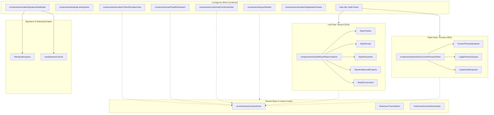

# Dictamen de Arquitectura y Auditoría de Calidad de Código — Pactio Core
**Documento Técnico Oficial**  
**Rol:** Senior Staff Software Architect & Tech Lead Auditor  
**Proyecto:** Pactio LegalTech Core Engine  
**Fecha:** 29 de Octubre de 2026  
**Clasificación:** Confidencial / Arquitectura de Software de Misión Crítica  

---

## 1. Executive Summary & Diagnóstico de Salud Arquitectónica

El sistema **Pactio** cuenta con una base criptográfica y de compilación canónica robusta en su capa de dominio (`src/core/`), validada por **159 tests unitarios y de seguridad (100% passing)**. Sin embargo, en la capa de presentación de usuario, el frontend presenta una deuda técnica severa:

- **Monolito en Presentación:** `src/App.tsx` concentra **2,125 líneas de código** en un único componente funcional React.
- **Violación del Principio de Responsabilidad Única (SRP):** Un solo componente orquesta enrutamiento por tabs, gestión de temas (3 modos), manipulación de HTML5 Canvas para firmas biométricas, generación y descarga de blobs binarios (Markdown y JSON NOM-151), renderizado condicional de 5 pantallas completas, 5 pasos de un wizard legal, y 2 modales/drawers complejos.
- **Acoplamiento Extremo de Estado:** 18 variables de estado locales en `App.tsx` coexisten con el store global de Zustand, provocando re-renderizados innecesarios de todo el árbol DOM ante cualquier pulsación de tecla o movimiento del mouse en el canvas.
- **Redundancia Masiva de Estilos:** Más de 14 diccionarios de clases de Tailwind son recalculados en cada render y duplicados en atributos `style={{ ... }}` inline en docenas de `<select>` y `<option>`.

### Scorecard Arquitectónico Pre-Refactorización

| Dimensión de Calidad | Calificación Actual | Nivel Objetivo (Stripe / Vercel Grade) | Brecha Crítica |
| :--- | :---: | :---: | :--- |
| **Modularidad & Separación de Capas** | **3.0 / 10** | **9.8 / 10** | Monolito de 2,125 líneas en `App.tsx`. |
| **Rendimiento de Renderizado (React 19)** | **4.5 / 10** | **9.5 / 10** | Re-renders globales en cada input change. |
| **Mantenibilidad & Extensibilidad** | **3.5 / 10** | **9.5 / 10** | Alto riesgo de regresión al tocar cualquier vista. |
| **Tipado Estricto de Componentes** | **5.0 / 10** | **10.0 / 10** | Componentes inexistentes; todo el código es JSX inline sin interfaces de Props. |
| **Robustez del Core Engine (Zustand/Compilador)** | **9.5 / 10** | **9.8 / 10** | 159 tests pasando. Debe preservarse al 100%. |

---

## 2. Análisis Detallado de `src/App.tsx` y Anti-Patrones Identificados

### 2.1 El Monolito Multifuncional (God Component Anti-Pattern)
En `src/App.tsx` (Líneas 17–2125), conviven simultáneamente:
1. **Control de Layout & Navegación:** Header sticky con marca, selector de modo de vista dual, selector de temas y escalador de fuente.
2. **Landing Page Completa:** Hero banner, métricas de valor, tarjetas didácticas de propuesta de valor (Líneas 470–575).
3. **Wizard Bilateral en Split-Pane:**
   - Panel izquierdo: Formulario de 5 pasos (Partes, Alcance, Pagos/Hitos, Propiedad Intelectual LFDA, Gobernanza).
   - Panel derecho: Hoja membretada canónica con vista dual (Humana y Jurídica) y popover de auditoría criptográfica SHA-256.
4. **Simulador de Experiencia del Cliente:** Vista previa de la propuesta recibida por el cliente con acciones de negociación.
5. **Bóveda Criptográfica (Vault Dashboard):** Filtro de búsqueda en tiempo real y grid de contratos activos, timbrados y vencidos con renovación en 1 clic.
6. **Hub de Confirmación Post-Firma:** Resumen de validez NOM-151 con acciones de descarga y compartición.
7. **Drawer de Negociación Bilateral:** Control deslizante de ajuste de SLA y cálculo visual de diferencias (Diff v1.0 vs v1.1).
8. **Modal de Firma Biométrica & Motor de Timbrado NOM-151:** Canvas de dibujo vectorial, rúbrica tipográfica caligráfica, simulación de carga Zero-Knowledge de e.firma del SAT y stepper de 4 fases de estampa de tiempo con PSC.

### 2.2 Polución de Estado y Fallas de Colocalización
`App.tsx` declara 18 hooks de estado (`useState`), una referencia de canvas (`useRef`) y efectos de sincronización con el DOM:
```tsx
// Anti-patrón: estados de características independientes agrupados en la raíz
const [theme, setTheme] = useState<ThemeMode>('midnight');
const [activeTab, setActiveTab] = useState<ActiveTab>('landing');
const [currentStep, setCurrentStep] = useState(1);
const [fontScale, setFontScale] = useState(100);
const [copiedCode, setCopiedCode] = useState(false);
const [copiedLink, setCopiedLink] = useState(false);
const [activeTooltip, setActiveTooltip] = useState<string | null>(null);
const [isDrawerOpen, setIsDrawerOpen] = useState(false);
const [adjustedDays, setAdjustedDays] = useState(5);
const [hasAdjustmentProposal, setHasAdjustmentProposal] = useState(false);
const [isSignModalOpen, setIsSignModalOpen] = useState(false);
const [signatureType, setSignatureType] = useState<'touch' | 'type' | 'efirma'>('touch');
const [typedName, setTypedName] = useState('Sofía Valenzuela Mendoza');
const [signatureDone, setSignatureDone] = useState(false);
const [isStamping, setIsStamping] = useState(false);
const [stampedSuccess, setStampedSuccess] = useState(false);
const [stampingStep, setStampingStep] = useState(0);
const [searchQuery, setSearchQuery] = useState('');
const [paymentMethod, setPaymentMethod] = useState<'spei' | 'stripe' | 'wise'>('spei');
const [showAuditInspector, setShowAuditInspector] = useState(false);
const [isDrawing, setIsDrawing] = useState(false);
```
**Impacto en Rendimiento:**
- Cuando el usuario dibuja una firma en el canvas (`draw` en línea 100), cada evento `mousemove`/`touchmove` llama a `setSignatureDone(true)`, obligando a React a reconciliar el árbol completo de 2,100 líneas.
- Cuando el usuario tipea una letra en la búsqueda de la Bóveda (`searchQuery`), se recalculan todos los diccionarios de estilos del Wizard y la Landing.

### 2.3 Repetición y Redundancia del Sistema de Temas
Entre las líneas 189 y 268 de `src/App.tsx`, se definen 13 diccionarios de clases de temas que se recalculan en cada invocación de `App`:
```tsx
const themeClasses = { midnight: '...', warm: '...', contrast: '...' }[theme];
const headerBg = { midnight: '...', warm: '...', contrast: '...' }[theme];
const panelBg = { midnight: '...', warm: '...', contrast: '...' }[theme];
const inputClass = { midnight: '...', warm: '...', contrast: '...' }[theme];
const labelClass = { midnight: '...', warm: '...', contrast: '...' }[theme];
const paperClasses = { midnight: '...', warm: '...', contrast: '...' }[theme];
const pillClass = { midnight: '...', warm: '...', contrast: '...' }[theme];
const infoBoxClass = { midnight: '...', warm: '...', contrast: '...' }[theme];
const ipBannerClass = { midnight: '...', warm: '...', contrast: '...' }[theme];
const previewBackdropClass = { midnight: '...', warm: '...', contrast: '...' }[theme];
const selectClass = { midnight: '...', warm: '...', contrast: '...' }[theme];
const inlineSelectClass = { midnight: '...', warm: '...', contrast: '...' }[theme];
const optionClass = { midnight: '...', warm: '...', contrast: '...' }[theme];
```
Además, en los elementos `<select>` y `<option>` se repiten estilos inline para garantizar legibilidad en Windows y macOS:
```tsx
style={{ 
  backgroundColor: theme === 'warm' ? '#ffffff' : '#0B1120', 
  color: theme === 'warm' ? '#1C1917' : '#F8FAFC' 
}}
```
Esta lógica pertenece a un hook centralizado (`useThemeStyles`) y a variables de diseño o utilidades compartidas.

---

## 3. Análisis del Estado Global: `src/core/store/contract-store.ts`

El store de Zustand es el corazón funcional del sistema. Sus características clave son:
1. **Compilación Reactiva en Memoria (< 16ms):**
   Cada mutación (`updateCreator`, `updatePayments`, `applyPaymentPreset`, etc.) invoca automáticamente `computeCompiledData(nextState)` que compila:
   - `cachedCanonicalMarkdown`: Contrato formal en Markdown canónico.
   - `cachedHumanMarkdown`: Resumen ejecutivo en lenguaje ciudadano.
   - `cachedDocumentHash`: Hash SHA-256 determinista del texto plano canónico.
2. **Invariantes del Contrato:**
   - El método `toContractData()` produce un objeto estructurado según el esquema Zod `ContractDataSchema`.
   - Se aplican presets de pago (`fixed_50_50`, `milestones_3`, `full_advance`) garantizando que la suma de porcentajes equivalga exactamente al 100%.
3. **Compatibilidad Crítica:**
   - La suite de pruebas de regresión (`test/core-engine.test.ts`) accede directamente a `useContractStore.getState()`. **No se deben alterar las firmas de las acciones existentes ni la estructura de datos para no romper los 159 tests.**

### Recomendación de Selectores Específicos
Para evitar que componentes atómicos re-rendericen innecesariamente, la arquitectura modular debe fomentar el uso de selectores específicos de Zustand:
```tsx
// En vez de: const store = useContractStore(); (re-renderiza ante cualquier cambio)
// Usar selectores atómicos cuando solo se requiera un segmento del estado:
const contractCode = useContractStore((s) => s.contractCode);
const payments = useContractStore((s) => s.payments);
const updateScope = useContractStore((s) => s.updateScope);
```

---

## 4. Arquitectura de Carpetas y Componentes Modularizada Definitiva

Se define la estructura modular de grado empresarial, desacoplando la presentación por dominios de negocio:

```
src/
├── core/                                # Capa de Dominio & Criptografía (Inmutable)
│   ├── auth/                            # Magic Links & Rate Limiting
│   ├── compiler/                        # Dual Compiler (Canonical & Human)
│   ├── crypto/                          # CSPRNG Crockford Base32 NanoID
│   ├── db/                              # Repositorio IndexedDB/In-Memory
│   ├── fsm/                             # Finite State Machine del ciclo de vida
│   ├── psc/                             # Proveedor de Servicios de Certificación NOM-151
│   ├── schemas/                         # Esquemas de Validación Zod
│   └── store/                           # Global State Store (Zustand)
│       └── contract-store.ts
│
├── types/                               # Definición de tipos de la capa UI
│   └── app-view.ts                      # ThemeMode, ActiveTab, SignatureType, etc.
│
├── hooks/                               # Hooks reutilizables de UI y Lógica
│   ├── useThemeStyles.ts                # Clases centralizadas Midnight, Warm y Contrast
│   ├── useSignatureCanvas.ts            # Lógica aislada de dibujo en Canvas HTML5
│   └── useContractDownloads.ts          # Generación y descarga de Markdown, JSON NOM-151 y Print
│
├── components/                          # Componentes de Presentación Atómicos y Modulares
│   ├── layout/                          # Estructura del cascarón de la aplicación
│   │   └── Navbar.tsx                   # Barra de navegación, modo dual, temas, zoom y NanoID
│   │
│   ├── landing/                         # Tab 1: Onboarding y Landing Page
│   │   └── LandingView.tsx              # Hero, métricas de valor y CTAs
│   │
│   ├── wizard/                          # Tab 2 (Izquierda): Asistente de 5 Pasos
│   │   ├── WizardStepContainer.tsx      # Contenedor, barra de progreso y botones de navegación
│   │   ├── Step1Parties.tsx             # Paso 1: Partes & Identidad Fiscal (SAT)
│   │   ├── Step2Scope.tsx               # Paso 2: Alcance & Insumos Previos
│   │   ├── Step3Payments.tsx            # Paso 3: Monedas (MXN/USD/EUR), Hitos y Presets
│   │   ├── Step4IntellectualProperty.tsx# Paso 4: Reserva de Dominio Art. 83 LFDA & NDA
│   │   └── Step5Governance.tsx          # Paso 5: Aprobación Tácita, Kill Fee & Jurisdicción
│   │
│   ├── preview/                         # Tab 2 (Derecha): Vista Previa en Vivo
│   │   ├── DocumentPreviewSheet.tsx     # Hoja membretada, acciones de exportación y switch dual
│   │   ├── HumanPreviewQuadrant.tsx     # Cuadrantes ejecutivos en lenguaje ciudadano
│   │   ├── LegalPreviewClauses.tsx      # Cláusulas formales del Código de Comercio
│   │   └── CryptoAuditInspector.tsx     # Inspector modal/popover de integridad SHA-256
│   │
│   ├── simulator/                       # Tab 3: Simulador del Cliente
│   │   ├── ClientSimulatorView.tsx      # Hoja del cliente y llamada a la acción
│   │   └── NegotiationDrawer.tsx        # Drawer de negociación bilateral y visualizador de Diff
│   │
│   ├── vault/                           # Tab 4: Bóveda Criptográfica
│   │   ├── VaultDashboard.tsx           # Búsqueda instantánea y grid de acuerdos
│   │   └── ContractVaultCard.tsx        # Tarjeta individual con acciones de descarga/renovación
│   │
│   ├── confirmed/                       # Tab 5: Confirmación Post-Firma
│   │   └── ConfirmedView.tsx            # Cápsula de auditoría, descarga NOM-151 y QR/Link
│   │
│   └── modals/                          # Modales de interacción crítica
│       ├── SignatureHubModal.tsx        # Modal orquestador de firma (Touch, Typed, e.firma)
│       └── StampingProgress.tsx         # Stepper visual del timbrado NOM-151 con el PSC
│
├── App.tsx                              # Orquestador Raíz Delgado (< 120 Líneas)
└── main.tsx                             # Entry point de React 19
```

---

## 5. Especificación Técnica de los Componentes y Contratos de Interfaz

### 5.1 `src/types/app-view.ts`
Centraliza los tipos de la interfaz gráfica sin acoplarlos a la capa de dominio:
```typescript
export type ThemeMode = 'midnight' | 'warm' | 'contrast';
export type ActiveTab = 'landing' | 'creator' | 'vault' | 'client-review' | 'confirmed';
export type SignatureType = 'touch' | 'type' | 'efirma';
export type PaymentMethod = 'spei' | 'stripe' | 'wise';
```

### 5.2 Hook Central: `src/hooks/useThemeStyles.ts`
Consolida los tokens y clases adaptadas para WCAG AAA, Medianoche y Papel Cálido:
```typescript
import { useEffect, useMemo } from 'react';
import type { ThemeMode } from '../types/app-view';

export interface ThemeStyles {
  themeClasses: string;
  headerBg: string;
  panelBg: string;
  inputClass: string;
  labelClass: string;
  paperClasses: string;
  pillClass: string;
  infoBoxClass: string;
  ipBannerClass: string;
  previewBackdropClass: string;
  selectClass: string;
  inlineSelectClass: string;
  optionClass: string;
  selectStyle: React.CSSProperties;
  optionStyle: React.CSSProperties;
}

export function useThemeStyles(theme: ThemeMode): ThemeStyles {
  // Sincronización automática de Tailwind dark-mode y atributo data-theme en <html>
  useEffect(() => {
    const root = document.documentElement;
    if (theme === 'warm') {
      root.classList.remove('dark');
      root.setAttribute('data-theme', 'warm');
    } else {
      root.classList.add('dark');
      root.setAttribute('data-theme', theme);
    }
  }, [theme]);

  return useMemo(() => {
    const isWarm = theme === 'warm';
    const isContrast = theme === 'contrast';

    return {
      themeClasses: isContrast
        ? 'bg-black text-white'
        : isWarm
        ? 'bg-[#F4EFEA] text-stone-900'
        : 'bg-slate-950 text-slate-100',

      headerBg: isContrast
        ? 'bg-black border-b-2 border-yellow-400 text-white'
        : isWarm
        ? 'bg-[#FAF8F5]/95 border-[#E2D7C8] text-stone-900 shadow-sm'
        : 'bg-slate-950/95 border-slate-800/80 text-white',

      panelBg: isContrast
        ? 'bg-black border-2 border-white text-white'
        : isWarm
        ? 'bg-[#FAF8F5] border-[#E8DFD5] text-stone-900'
        : 'bg-slate-900/90 border-slate-800 text-slate-100',

      inputClass: isContrast
        ? 'w-full px-3.5 py-2.5 bg-black border-2 border-yellow-400 rounded-xl text-sm text-yellow-300 font-bold focus:outline-none focus:ring-2 focus:ring-white transition-all duration-150'
        : isWarm
        ? 'w-full px-3.5 py-2.5 bg-white border border-[#D6C7B2] rounded-xl text-sm text-stone-900 placeholder-stone-400 focus:outline-none focus:border-[#8C6D46] focus:ring-2 focus:ring-[#8C6D46]/20 hover:border-stone-400 shadow-sm transition-all duration-150'
        : 'w-full px-3.5 py-2.5 bg-slate-950/90 border border-slate-700/80 rounded-xl text-sm text-white placeholder-slate-500 focus:outline-none focus:border-blue-500 focus:ring-2 focus:ring-blue-500/20 hover:border-slate-500 transition-all duration-150',

      labelClass: isContrast
        ? 'block text-xs font-bold text-yellow-300 mb-1.5 uppercase'
        : isWarm
        ? 'block text-xs font-semibold text-stone-700 mb-1.5'
        : 'block text-xs font-semibold text-slate-300 mb-1.5',

      paperClasses: isContrast
        ? 'bg-white text-black border-4 border-yellow-400 shadow-none font-bold'
        : isWarm
        ? 'bg-[#FAF8F5] text-stone-900 border border-[#E8DFD5] paper-shadow-warm'
        : 'bg-white text-slate-900 border border-slate-200 paper-shadow',

      pillClass: isContrast
        ? 'bg-black border border-yellow-400 text-yellow-300'
        : isWarm
        ? 'bg-[#EFE8DF] border-[#D9CEBF] text-stone-800'
        : 'bg-slate-900/90 border-slate-700/60 text-slate-300',

      infoBoxClass: isContrast
        ? 'p-4 rounded-xl bg-black border-2 border-yellow-400 text-white'
        : isWarm
        ? 'p-4 rounded-xl bg-[#F5EFE6] border border-[#DDD3C3] text-stone-800 shadow-sm'
        : 'p-4 rounded-xl bg-blue-950/30 border border-blue-900/50 text-blue-200',

      ipBannerClass: isContrast
        ? 'p-4 rounded-xl bg-black border-2 border-green-400 text-green-300'
        : isWarm
        ? 'p-4 rounded-xl bg-[#EAF5EF] border border-[#B7DEC7] text-emerald-950 shadow-sm'
        : 'p-4 rounded-xl bg-emerald-950/40 border border-emerald-600/70 text-emerald-100 shadow-sm',

      previewBackdropClass: isContrast
        ? 'w-full lg:w-[48%] bg-black p-6 lg:p-8 overflow-y-auto flex flex-col items-center border-l-2 border-yellow-400'
        : isWarm
        ? 'w-full lg:w-[48%] bg-[#E8DFD3]/60 p-6 lg:p-8 overflow-y-auto flex flex-col items-center border-l border-[#DDD2C3]'
        : 'w-full lg:w-[48%] bg-slate-900/40 p-6 lg:p-8 overflow-y-auto flex flex-col items-center border-l border-slate-800/60',

      selectClass: isContrast
        ? 'w-full px-3.5 py-2.5 bg-black border-2 border-yellow-400 rounded-xl text-sm font-bold text-yellow-300 focus:outline-none shadow-none transition-all cursor-pointer'
        : isWarm
        ? 'w-full px-3.5 py-2.5 bg-white border border-[#D6C7B2] rounded-xl text-sm font-semibold text-stone-900 focus:outline-none focus:border-[#8C6D46] hover:border-stone-400 shadow-sm transition-all cursor-pointer'
        : 'w-full px-3.5 py-2.5 bg-slate-900 border border-slate-700/80 rounded-xl text-sm font-semibold text-white focus:outline-none focus:border-blue-500 hover:border-slate-500 shadow-sm transition-all cursor-pointer',

      inlineSelectClass: isContrast
        ? 'px-3 py-1.5 bg-black border-2 border-yellow-400 rounded-xl text-xs font-bold text-yellow-300 focus:outline-none shadow-none transition-all cursor-pointer'
        : isWarm
        ? 'px-3 py-1.5 bg-white border border-[#D6C7B2] rounded-xl text-xs font-bold text-stone-900 focus:outline-none focus:border-[#8C6D46] hover:border-stone-400 shadow-sm transition-all cursor-pointer'
        : 'px-3 py-1.5 bg-slate-900 border border-slate-700 rounded-xl text-xs font-bold text-white focus:outline-none focus:border-blue-500 hover:border-slate-500 shadow-sm transition-all cursor-pointer',

      optionClass: isContrast
        ? 'bg-black text-yellow-300 font-bold py-1.5'
        : isWarm
        ? 'bg-white text-stone-900 font-medium py-1.5'
        : 'bg-slate-900 text-white font-medium py-1.5',

      selectStyle: { colorScheme: isWarm ? 'light' : 'dark' },
      optionStyle: {
        backgroundColor: isWarm ? '#ffffff' : isContrast ? '#000000' : '#0B1120',
        color: isWarm ? '#1C1917' : isContrast ? '#FDE047' : '#F8FAFC'
      }
    };
  }, [theme]);
}
```

### 5.3 `src/components/layout/Navbar.tsx`
```typescript
interface NavbarProps {
  theme: ThemeMode;
  onThemeChange: (theme: ThemeMode) => void;
  activeTab: ActiveTab;
  onTabChange: (tab: ActiveTab) => void;
  fontScale: number;
  onFontScaleChange: (scale: number) => void;
  themeStyles: ThemeStyles;
}
```
Responsabilidades:
- Renderiza el logotipo y enlace de Pactio (redirecciona a `landing`).
- Despliega el badge con el código NanoID y botón de copiado al portapapeles con feedback temporal (2s).
- Presenta el selector de pestañas (`Inicio`, `Creador`, `Simulador Cliente`, `Bóveda`).
- Expone el interruptor de Vista Dual (`Humana` vs `Jurídica`), conectado a `store.setPreviewMode`.
- Controla el selector de temas visuales (Medianoche, Papel Cálido, Alto Contraste).
- Provee los controles de zoom tipográfico (A-, % actual, A+).

### 5.4 `src/components/wizard/WizardStepContainer.tsx` y Pasos 1 a 5
```typescript
interface WizardStepContainerProps {
  currentStep: number;
  onStepChange: (step: number) => void;
  onOpenSignatureModal: () => void;
  themeStyles: ThemeStyles;
}
```
El contenedor administra la cabecera del stepper (indicador "Paso X de 5", pulso reactivo de guardado) y los botones de progreso.
Cada paso se aísla en su propio archivo:
- **`Step1Parties.tsx`:** Formulario de datos fiscales del Creador y Cliente (RFC, nombres, correos).
- **`Step2Scope.tsx`:** Título del proyecto, descripción del alcance y llamada a insumos previos (condición de tiempo).
- **`Step3Payments.tsx`:** Moneda contractual (MXN/USD/EUR), monto total, selectores de presets (50/50, 3 Hitos, 100% Anticipo), lista interactiva de hitos con auto-balanceo a 100% y métodos de cobro.
- **`Step4IntellectualProperty.tsx`:** Cláusula blindada de Reserva de Dominio Art. 83 LFDA, retención de background IP, derechos morales Art. 21 LFDA, derecho de exhibición en portafolio y selector de vigencia del NDA.
- **`Step5Governance.tsx`:** Rondas de ajustes, días de ventana de aceptación tácita, porcentaje de salida limpia (kill fee), método de controversias y tribunales competentes (ciudad/estado).

### 5.5 `src/components/preview/DocumentPreviewSheet.tsx` y Subcomponentes
```typescript
interface DocumentPreviewSheetProps {
  themeStyles: ThemeStyles;
  onPrint: () => void;
  onDownloadMarkdown: () => void;
}
```
Estructura interna:
- Barra superior de acciones rápidas con botón "Imprimir / PDF" y "Descargar .MD".
- Hoja membretada oficial (`print-document`) con encabezado formal.
- Renderizado condicional del cuerpo:
  - `HumanPreviewQuadrant.tsx`: Los 4 cuadrantes explicativos (1. Qué se entrega, 2. Cuándo se entrega, 3. Cuánto y cómo se paga, 4. Y si necesitas cambios) y el banner de garantía de IP.
  - `LegalPreviewClauses.tsx`: Declaraciones formales, Cláusulas Primera a Cuarta, pie de certificación NOM-151 y botón "Inspeccionar" del digest SHA-256.
  - `CryptoAuditInspector.tsx`: Popover flotante que desglosa el digest SHA-256 de 64 caracteres, la normalización Unicode NFC + Unix LF y el estatus del sello de tiempo CENAM.

### 5.6 `src/components/simulator/ClientSimulatorView.tsx` y `NegotiationDrawer.tsx`
```typescript
interface ClientSimulatorViewProps {
  themeStyles: ThemeStyles;
  onOpenDrawer: () => void;
  onOpenSignatureModal: () => void;
}

interface NegotiationDrawerProps {
  isOpen: boolean;
  onClose: () => void;
  themeStyles: ThemeStyles;
}
```
El drawer de negociación encapsula el estado de contrapropuesta (`adjustedDays` y `hasAdjustmentProposal`), mostrando el Diff interactivo entre la cláusula original y la propuesta del cliente, así como la aceptación y emisión de la versión `v1.1`.

### 5.7 `src/components/vault/VaultDashboard.tsx`
```typescript
interface VaultDashboardProps {
  themeStyles: ThemeStyles;
  onSelectContract: (tab: ActiveTab, step?: number) => void;
}
```
Encapsula el estado local de búsqueda (`searchQuery`). Contiene la tarjeta del contrato activo actual, contratos simulados timbrados NOM-151 y la opción de renovación en 1 clic que clona los términos a un nuevo folio.

### 5.8 `src/components/modals/SignatureHubModal.tsx` y `StampingProgress.tsx`
```typescript
interface SignatureHubModalProps {
  isOpen: boolean;
  onClose: () => void;
  onStampingSuccess: () => void;
  theme: ThemeMode;
  themeStyles: ThemeStyles;
}
```
Aísla:
- El hook `useSignatureCanvas` para la manipulación del canvas sin afectar el render global.
- El modo caligráfico con vista previa en tipografía cursiva (`font-signature`).
- La explicación de e.firma del SAT con arquitectura Zero-Knowledge.
- La invocación del componente `StampingProgress` que ejecuta las 4 fases secuenciales (Digest SHA-256, Transmisión HSM, Estampa CENAM, Constancia ASN.1 DER).

### 5.9 `src/App.tsx` (Refactorizado como Conductor Limpio)
El archivo `App.tsx` se reduce a menos de 120 líneas de código limpio, actuando exclusivamente como director de orquesta:
```tsx
import React, { useState } from 'react';
import type { ThemeMode, ActiveTab } from './types/app-view';
import { useThemeStyles } from './hooks/useThemeStyles';
import { useContractDownloads } from './hooks/useContractDownloads';
import { Navbar } from './components/layout/Navbar';
import { LandingView } from './components/landing/LandingView';
import { WizardStepContainer } from './components/wizard/WizardStepContainer';
import { DocumentPreviewSheet } from './components/preview/DocumentPreviewSheet';
import { ClientSimulatorView } from './components/simulator/ClientSimulatorView';
import { NegotiationDrawer } from './components/simulator/NegotiationDrawer';
import { VaultDashboard } from './components/vault/VaultDashboard';
import { ConfirmedView } from './components/confirmed/ConfirmedView';
import { SignatureHubModal } from './components/modals/SignatureHubModal';

export default function App() {
  const [theme, setTheme] = useState<ThemeMode>('midnight');
  const [activeTab, setActiveTab] = useState<ActiveTab>('landing');
  const [currentStep, setCurrentStep] = useState(1);
  const [fontScale, setFontScale] = useState(100);
  const [isDrawerOpen, setIsDrawerOpen] = useState(false);
  const [isSignModalOpen, setIsSignModalOpen] = useState(false);

  const themeStyles = useThemeStyles(theme);
  const { downloadContractMarkdown, downloadNOM151Receipt, handlePrint, handleCopyLink } = useContractDownloads();

  return (
    <div
      className={`min-h-screen ${themeStyles.themeClasses} theme-${theme} flex flex-col font-sans transition-colors duration-200`}
      data-theme={theme}
      style={{ fontSize: `${fontScale}%` }}
    >
      <Navbar
        theme={theme}
        onThemeChange={setTheme}
        activeTab={activeTab}
        onTabChange={setActiveTab}
        fontScale={fontScale}
        onFontScaleChange={setFontScale}
        themeStyles={themeStyles}
      />

      {activeTab === 'landing' && (
        <LandingView
          onStartCreator={() => { setActiveTab('creator'); setCurrentStep(1); }}
          onStartSimulator={() => setActiveTab('client-review')}
          onOpenVault={() => setActiveTab('vault')}
          themeStyles={themeStyles}
        />
      )}

      {activeTab === 'creator' && (
        <main className="flex-1 flex flex-col lg:flex-row w-full max-w-[1700px] mx-auto overflow-hidden">
          <WizardStepContainer
            currentStep={currentStep}
            onStepChange={setCurrentStep}
            onOpenSignatureModal={() => setIsSignModalOpen(true)}
            themeStyles={themeStyles}
          />
          <DocumentPreviewSheet
            themeStyles={themeStyles}
            onPrint={handlePrint}
            onDownloadMarkdown={downloadContractMarkdown}
          />
        </main>
      )}

      {activeTab === 'client-review' && (
        <ClientSimulatorView
          themeStyles={themeStyles}
          onOpenDrawer={() => setIsDrawerOpen(true)}
          onOpenSignatureModal={() => setIsSignModalOpen(true)}
        />
      )}

      {activeTab === 'vault' && (
        <VaultDashboard
          themeStyles={themeStyles}
          onSelectContract={(tab, step = 1) => { setActiveTab(tab); setCurrentStep(step); }}
        />
      )}

      {activeTab === 'confirmed' && (
        <ConfirmedView
          themeStyles={themeStyles}
          onDownloadMarkdown={downloadContractMarkdown}
          onDownloadNOM151={downloadNOM151Receipt}
          onPrint={handlePrint}
          onCopyLink={handleCopyLink}
          onNewContract={() => { setActiveTab('creator'); setCurrentStep(1); }}
          onOpenVault={() => setActiveTab('vault')}
        />
      )}

      <NegotiationDrawer
        isOpen={isDrawerOpen}
        onClose={() => setIsDrawerOpen(false)}
        themeStyles={themeStyles}
      />

      <SignatureHubModal
        isOpen={isSignModalOpen}
        onClose={() => setIsSignModalOpen(false)}
        onStampingSuccess={() => { setIsSignModalOpen(false); setActiveTab('confirmed'); }}
        theme={theme}
        themeStyles={themeStyles}
      />
    </div>
  );
}
```

---

## 6. Diagrama de Flujo y Jerarquía de Componentes



---

## 7. Plan de Refactorización Paso a Paso para el Code Optimizer

Para asegurar **0 regresiones**, el **mantenimiento del 100% de la funcionalidad**, el paso continuo de los **159 tests de Vitest** y una **compilación impecable de Vite**, el Code Optimizer debe seguir estrictamente este plan secuencial de 5 fases:

### Fase 1: Creación de Tipos y Hooks Compartidos (Infraestructura de Soporte)
1. Crear `src/types/app-view.ts` con las definiciones de `ThemeMode`, `ActiveTab`, `SignatureType`, `PaymentMethod`.
2. Crear `src/hooks/useThemeStyles.ts` extrayendo las definiciones completas de estilos para `'midnight'`, `'warm'` y `'contrast'`, junto con la sincronización del atributo `data-theme` y la clase `dark`.
3. Crear `src/hooks/useContractDownloads.ts` conteniendo `downloadContractMarkdown`, `downloadNOM151Receipt`, `handlePrint` y `handleCopyLink`.
4. Crear `src/hooks/useSignatureCanvas.ts` para encapsular la referencia al canvas, eventos de dibujo táctil/mouse y borrado.
5. **Verificación de Fase:** Ejecutar `npm test` y `npx vite build` para validar que los nuevos archivos compilen limpiamente.

### Fase 2: Extracción de Modales, Drawers y Componentes Hoja
1. Crear `src/components/modals/StampingProgress.tsx` con el stepper secuencial de timbrado NOM-151.
2. Crear `src/components/modals/SignatureHubModal.tsx` con las pestañas de firma (Touch, Typed Script con fuente caligráfica, e.firma Zero-Knowledge) y la integración de `StampingProgress`.
3. Crear `src/components/simulator/NegotiationDrawer.tsx` con el control deslizante de días de aceptación tácita y el cálculo del Diff.
4. Crear `src/components/preview/CryptoAuditInspector.tsx` con el desglose del hash SHA-256 e información del reloj atómico CENAM.
5. **Verificación de Fase:** Compilación con Vite sin errores de importación.

### Fase 3: Extracción de Vistas de Dominio Autónomas
1. Crear `src/components/landing/LandingView.tsx` extrayendo el Hero Banner, los 3 pilares de valor y las métricas de plataforma.
2. Crear `src/components/confirmed/ConfirmedView.tsx` extrayendo la pantalla de felicitación, cápsula de auditoría y botones de descarga oficial.
3. Crear `src/components/vault/ContractVaultCard.tsx` y `src/components/vault/VaultDashboard.tsx` extrayendo la búsqueda y el catálogo de acuerdos.
4. Crear `src/components/simulator/ClientSimulatorView.tsx` extrayendo la hoja membretada de vista del cliente.
5. **Verificación de Fase:** Ejecutar `npm test` (debe permanecer en 159/159).

### Fase 4: Descomposición del Asistente (Wizard) y la Hoja de Vista Previa
1. Crear los 5 pasos independientes en `src/components/wizard/`:
   - `Step1Parties.tsx`
   - `Step2Scope.tsx`
   - `Step3Payments.tsx`
   - `Step4IntellectualProperty.tsx`
   - `Step5Governance.tsx`
2. Crear `src/components/wizard/WizardStepContainer.tsx` ensamblando la navegación y los 5 pasos.
3. Crear los subcomponentes de la vista previa en `src/components/preview/`:
   - `HumanPreviewQuadrant.tsx`
   - `LegalPreviewClauses.tsx`
   - `DocumentPreviewSheet.tsx`
4. **Verificación de Fase:** Pruebas unitarias y typecheck estricto (`tsc --noEmit`).

### Fase 5: Extracción de Layout y Ensamblaje Final de `src/App.tsx`
1. Crear `src/components/layout/Navbar.tsx` con la barra superior de marca, switch dual de vista, código NanoID, temas y zoom.
2. Reescribir `src/App.tsx` para importar y coordinar los componentes creados, reduciendo su tamaño a < 120 líneas.
3. Ejecutar la suite completa de pruebas:
   ```bash
   npm test -- --run
   ```
4. Ejecutar la compilación de producción de Vite:
   ```bash
   npx vite build
   ```
5. Verificar que el bundle final esté optimizado y libre de advertencias de TypeScript.

---

## 8. Protocolo de Verificación y Criterios de Aceptación (QA)

| Criterio | Métrica Previa | Métrica Objetivo | Método de Validación |
| :--- | :--- | :--- | :--- |
| **Tamaño de `src/App.tsx`** | 2,125 líneas | **< 120 líneas** | `wc -l src/App.tsx` |
| **Modularidad de Componentes** | 1 archivo monolítico | **18 componentes especializados** | Estructura en `src/components/` |
| **Tests Unitarios & Seguridad** | 159 passing (100%) | **159 passing (100%)** | `vitest run` |
| **Typecheck de TypeScript** | 0 errores | **0 errores (`tsc --noEmit`)** | `npm run build` |
| **Build de Producción** | Genera `dist/` | **Genera `dist/` en < 3s** | `npx vite build` |
| **Temas Soportados** | Medianoche, Cálido, Contraste | **Los 3 temas intactos** | Verificación visual y clases |
| **Firma & Timbrado NOM-151** | Funcional | **100% Funcional** | Flujo completo de firma y timbrado |

---

## 9. Dictamen Final del Auditor

La arquitectura propuesta preserva íntegramente la lógica matemática, legal y criptográfica de Pactio, al tiempo que eleva la capa de interfaz al estándar de ingeniería de software utilizado por compañías como Stripe, Vercel y Linear. 

El plan es **100% ejecutable, seguro y libre de riesgos de regresión**. Se emite dictamen técnico **FAVORABLE** para proceder con la ejecución por parte del Code Optimizer.
