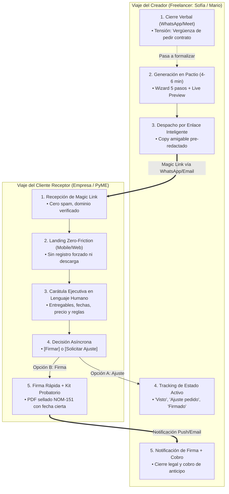
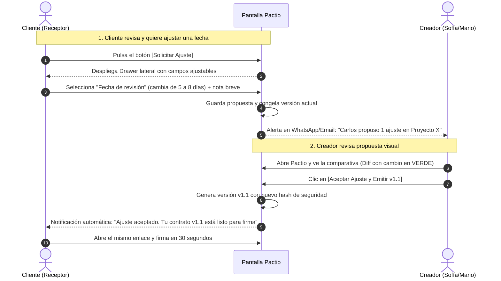
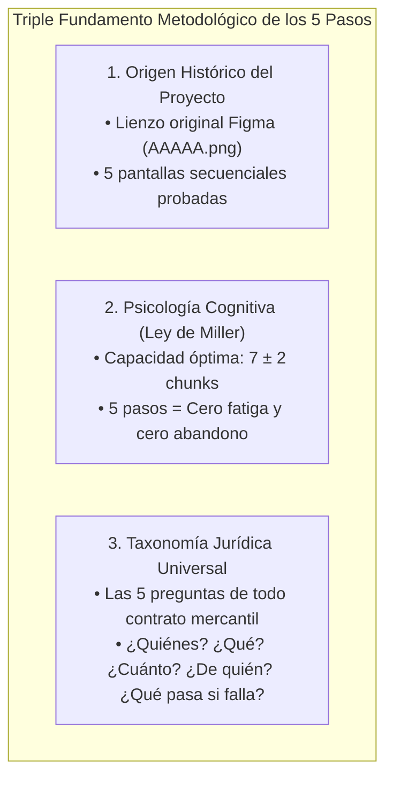
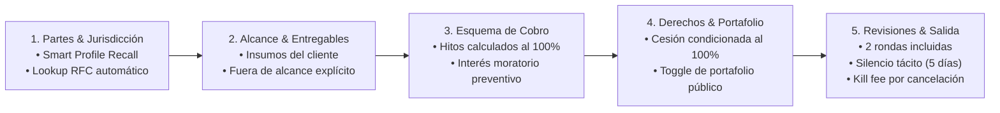
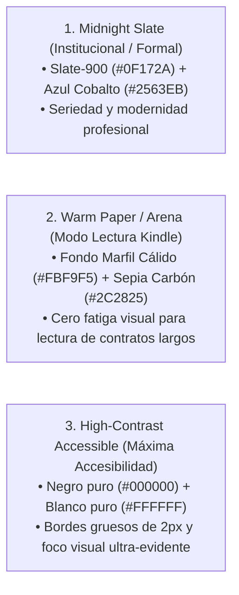
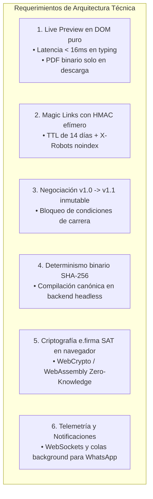

# Especificación de Diseño UX/UI & CX Bilateral: Pactio
**La Plataforma de Acuerdos Inteligentes "Lawyer-Ready" para Profesionales Independientes**

> [!NOTE]
> **Documento de Arquitectura de Experiencia y Diseño de Producto (Versión Integral 2.0)**  
> **Autor**: Lead UX/UI & CX Specialist  
> **Destinatario**: Dirección de Producto (PM), Frontend/Fullstack Engineering & LegalTech Advisory  
> **Marco Metodológico**: Heurísticas de Jakob Nielsen, Psicología del Comportamiento (Kahneman, Cialdini, Fogg, Sweller, Miller), Legal Design (Stanford Legal Design Lab / Margaret Hagan) y Estándares de Accesibilidad Universal **WCAG 2.1 AAA**.

---

## 1. CX BILATERAL: El Viaje del Creador y del Cliente Receptor

En servicios profesionales independientes, un contrato no es un trámite administrativo unilateral; es un **rito de iniciación relacional**. Si la experiencia hace sentir al cliente bajo sospecha o al freelancer como un burócrata agresivo, el acuerdo fracasa antes de nacer. Por ello, la experiencia del cliente (CX) debe diseñarse de forma estrictamente simétrica.



---

### 1.1. Mapeo de Touchpoints Extremo a Extremo (E2E Customer Journey)

| Fase | Touchpoint Freelancer (Creador) | Touchpoint Cliente (Receptor) | Emoción Predominante | Riesgo de Abandono | Mitigación CX de Pactio |
| :--- | :--- | :--- | :--- | :--- | :--- |
| **1. Iniciación** | Acuerdan alcance verbal o por chat. Sofía abre Pactio. | Espera la confirmación de inicio del trabajo. | Freelancer: Ansiedad / Inseguridad.<br>Cliente: Expectativa. | Que el freelancer decida "no molestar al cliente con papeles" y empiece sin contrato. | **Plantillas One-Click**: Sofía genera el borrador en 4 min con valores predeterminados de su industria. |
| **2. Creación** | Wizard de 5 pasos en Split-Pane con visualización reactiva del contrato. | N/A (Estado de espera). | Freelancer: Empoderamiento y control. | Fatiga cognitiva si hay más de 15 preguntas densas. | **Divulgación Progresiva**: 3 preguntas clave por módulo y autocompletado inteligente. |
| **3. Compartición** | Pantalla de éxito: Modal con botón de copiar enlace y opciones de mensaje para WhatsApp o Correo. | Recibe mensaje en WhatsApp o Correo: *"Sofía te ha compartido el resumen de colaboración para [Proyecto X]"*. | Freelancer: Alivio relacional.<br>Cliente: Curiosidad / Cautela. | Si el mensaje parece spam o amenaza legal, el cliente no hace clic. | **Microcopia de "Tercero Neutral"**: Mensaje redactado enfocando el beneficio en la fecha de entrega y orden fiscal del cliente. |
| **4. Recepción** | Dashboard con estado: *"Enviado · Esperando apertura"*. | Abre el link. Pantalla instantánea (Carga en < 1s) con avatar verificado de Sofía y badge de seguridad. | Cliente: Sorpresa positiva ante la claridad. | Miedo al phishing o pereza si se le pide crear cuenta y contraseña. | **Zero-Login Experience**: Acceso instantáneo autenticado por token HMAC criptográfico en la URL. |
| **5. Comprensión** | Dashboard actualiza: *"Visto hace 2 min"*. | Lee la **Carátula Ejecutiva** de 4 cuadrantes. Puede alternar a *"Texto Legal Detallado"* si lo desea. | Cliente: Confianza (Sistema 1 de Kahneman satisfecho). | Miedo a "trampas ocultas" en cláusulas largas. | **Simetría Visual**: Las obligaciones de entrega del freelancer tienen el mismo peso visual que los pagos del cliente. |
| **6. Resolución** | Si pide ajuste: Notificación con diff visual en verde. Si aprueba: Notificación de firma en curso. | Toma acción: Botón principal `[Aprobar y Firmar]` o botón secundario `[Solicitar Ajuste]`. | Cliente: Sensación de trato justo y colaborativo. | Estancamiento en negociaciones eternas por correo o Word. | **Negociación Asíncrona Paramétrica**: El cliente propone cambios visualmente sin romper el contrato. |
| **7. Firma** | Recibe confirmación push: *"¡Proyecto activado! Contrato formalizado con fecha cierta"*. | Firma con rúbrica táctil en pantalla o con e.firma (SAT). Descarga inmediata del PDF con certificado NOM-151. | Ambos: Certidumbre absoluta y profesionalismo. | Errores en canvas táctil o desconfianza en la validez legal. | **Sello Probatorio Visible**: Hash SHA-256 visible + estampa NOM-151 para deducción fiscal y defensa legal. |

---

### 1.2. Puntos de Fricción Emocional y Soluciones Psicológicas

#### A. Calmar la Ansiedad Legal del Freelancer ("Miedo a pedir contrato")
* **Diagnóstico Psicológico**: El freelancer sufre el **Efecto de Proyección Social**: teme que pedir un contrato transmita el mensaje implícito *"no confío en tu palabra"*.
* **Solución de CX — El Principio del Escudo de Tercero (*Third-Party Legitimacy*)**:
  Pactio no entrega un documento frío para adjuntar; entrega un **asistente de comunicación**. Al finalizar el contrato, Pactio ofrece 3 plantillas de mensaje listas para copiar y pegar en WhatsApp:
  > *"Hola Carlos, para proteger tus fechas de entrega y dejar asentado el alcance exacto conforme a los requisitos fiscales para la deducción del proyecto ante el SAT, te comparto el resumen operativo en este enlace seguro de Pactio: [link]. Lo puedes revisar y aprobar desde tu celular en 1 minuto."*
* **Efecto Psicológico**: El freelancer desvía la "fricción burocrática" hacia un requerimiento estándar de gobernanza operativa y fiscal del SAT. El contrato deja de ser una sospecha personal y se convierte en una muestra de rigor profesional.

#### B. Eliminar el Miedo del Cliente Receptor ("Miedo a letras chiquitas y enlaces desconocidos")
* **Diagnóstico Psicológico**: Según la **Teoría de la Disonancia Cognitiva y Aversión a la Pérdida (Kahneman & Tversky)**, cuando un cliente ve un enlace desconocido o un PDF de 15 páginas en tipografía compacta, asume por defecto el peor escenario: trampas legales, cláusulas de amarre o cargos automáticos ocultos.
* **Solución de CX — Arquitectura de Confianza en 3 Capas**:
  1. **Capa 1: Cabecera Institucional Neutra**: El enlace muestra la identidad visual del freelancer (foto, nombre, portafolio) junto con el sello: *"Acuerdo Asistido en Pactio · Plataforma Segura NOM-151"*.
  2. **Capa 2: La Carátula Ejecutiva de 60 Segundos (*Executive Summary Board*)**: Antes de mostrar una sola cláusula redactada en prosa jurídica, el cliente ve un tablero visual en lenguaje común dividido en 4 pilares:
     * **¿Qué vas a recibir?**: Lista de entregables y formatos finales.
     * **¿Cuándo se entrega?**: Cronograma con fechas límite garantizadas.
     * **¿Cuánto y cómo se paga?**: Hitos transparentes (ej. 50% anticipo / 50% entrega final).
     * **¿Qué pasa si quieres cambios?**: 2 rondas de revisión incluidas y costo pactado por cambio extra.
  3. **Capa 3: "Garantía de Cero Trampas" (Simetría Bilateral)**: El diseño ubica lado a lado las protecciones de ambas partes. Por ejemplo: *"Si el freelancer se retrasa más de 5 días hábiles sin causa de fuerza mayor, aplica un descuento del 1% diario"* frente a *"Si el cliente se retrasa en el pago de un hito, el calendario de entrega se congela proporcionalmente"*. La equidad visible desactiva el mecanismo de defensa del cliente.

---

### 1.3. El Flujo Intuitivo de Negociación Asíncrona (Anti-Happy Path)

> [!TIP]
> **Definición Coloquial del Flujo**:  
> *"Si el cliente quiere cambiar una fecha o porcentaje, no se sale de la app; pulsa `[Solicitar Ajuste]`, propone el cambio en un drawer visual, al creador le llega una alerta clara con diff en verde, aprueba con 1 clic y se emite la v1.1 para firma inmediata."*

En la vida real, los acuerdos casi nunca se firman al primer intento sin alguna pequeña modificación. El error de las herramientas tradicionales es obligar a descargar el archivo en Word o volver a correos infinitos. En Pactio, la negociación es **100% asíncrona, visual y dentro del mismo enlace**:



#### Interfaz del Drawer de Ajuste y Diff Visual (Lo que ven las partes)

```
┌─────────────────────────────────────────────────────────────────────────────┐
│ SOLICITAR AJUSTE EN CONDICIONES DEL PROYECTO                   [ Cerrar ✕ ] │
├─────────────────────────────────────────────────────────────────────────────┤
│ Selecciona qué condición deseas proponer modificar:                         │
│                                                                             │
│ [  Calendario de Entrega  ]  [• Distribución de Pagos •]  [  Revisiones  ]  │
│                                                                             │
│ Modificación Propuesta en Hitos de Pago:                                    │
│  • Condición actual:   Hito 1 (50% Anticipo)  /  Hito 2 (50% Liquidación)   │
│  • Tu propuesta:       [ 40% Anticipo ]  +  [ 30% Hito 1 ]  +  [ 30% Fin ]  │
│                                                                             │
│ Mensaje breve para el profesional:                                          │
│ ┌─────────────────────────────────────────────────────────────────────────┐ │
│ │ "Hola Sofía, para que administración libere el presupuesto requerimos  │ │
│ │  dividir el pago en 3 hitos en lugar de 2. El total ($30,000) se respeta│ │
│ └─────────────────────────────────────────────────────────────────────────┘ │
│                                                                             │
│ [   ENVIAR PROPUESTA DE AJUSTE A SOFÍA   ]                                  │
└─────────────────────────────────────────────────────────────────────────────┘
```

Al enviar la solicitud, el freelancer ve inmediatamente en su pantalla una tarjeta de comparación directa:

```
┌─────────────────────────────────────────────────────────────────────────────┐
│ 🔔 CARLOS SOLICITÓ UN AJUSTE EN EL PROYECTO "REDISEÑO APP"                  │
├─────────────────────────────────────────────────────────────────────────────┤
│ Comparativa de Términos (Diff Visual):                                      │
│                                                                             │
│  ANTES (v1.0):                                                              │
│  - Hito 1: 50% ($15,000 MXN) al inicio.                                     │
│  - Hito 2: 50% ($15,000 MXN) a la entrega final.                            │
│                                                                             │
│  PROPUESTA RECIBIDA (Para v1.1):                                            │
│  + Hito 1: 40% ($12,000 MXN) al inicio. [MODIFICADO]                        │
│  + Hito 2: 30% ($9,000 MXN) a la entrega de wireframes. [NUEVO]             │
│  + Hito 3: 30% ($9,000 MXN) a la entrega final. [MODIFICADO]                │
│                                                                             │
│  Comentario del cliente: "Para que administración libere el presupuesto..." │
│                                                                             │
│  [ ✓ Aceptar Ajuste y Emitir v1.1 ]         [ 💬 Responder / Contraofertar ]│
└─────────────────────────────────────────────────────────────────────────────┘
```

#### ¿Qué PUEDE y qué NO PUEDE editar el cliente? (Matriz de Gobernanza Paramétrica)

Para evitar que el cliente desmantele la seguridad jurídica del freelancer o transforme el contrato en un texto ambiguo, el cliente **nunca edita texto libre sobre las cláusulas legales**, sino valores específicos acotados:

| Parámetro | ¿Puede ajustarlo el cliente? | Opciones que la interfaz permite proponer | Lo que el sistema BLOQUEA rotundamente |
| :--- | :---: | :--- | :--- |
| **Distribución de Hitos** | **SÍ** | Dividir los pagos en más exhibiciones (ej. 40%-30%-30%), siempre que la suma sea exactamente 100%. | **Prohibido proponer 0% de anticipo** en proyectos mayores a $500 USD. Se protege el flujo de caja del profesional. |
| **Plazos de Revisión** | **SÍ** | Extender la ventana de revisión del cliente de 5 a 7 u 8 días hábiles para adecuarse a sus juntas directivas. | Reducir el tiempo de trabajo del creador a plazos imposibles o no contemplados en la cotización. |
| **Rondas de Cambios** | **SÍ** | Solicitar 1 ronda adicional de revisión (ej. pasar de 2 a 3) aceptando el ajuste proporcional de tarifa. | Exigir "revisiones ilimitadas" (esa opción ni siquiera existe en la base de datos). |
| **Propiedad Intelectual** | ❌ **BLOQUEADO** | Ninguna. | **Inviolable**: Los derechos del diseño o código se transfieren *única y exclusivamente tras el pago del 100%*. |
| **Cláusula Penal por Retraso** | ❌ **BLOQUEADO** | Ninguna. | El cliente no puede eliminar los intereses de mora ni las penalizaciones si incumple los pagos. |
| **Jurisdicción y Ley** | ❌ **BLOQUEADO** | Puede sugerir cambio de ciudad mediante nota, pero no puede forzar juzgados en el extranjero. | Mantener tribunales neutros y de la plaza de prestación del servicio. |

---

## 2. ARQUITECTURA DE UX & INTERACCIÓN (El Creador)

### 2.1. Diseño Responsivo Integral en 4 Breakpoints

Pactio no se limita a "achicar la pantalla"; resuelve la ergonomía cognitiva y visual para cuatro contextos reales de uso:

```
+----------------------------------------------------------------------------------------------------+
| 1. ULTRA-WIDE / 4K / 2K (>= 1440px / 1920px): Lectura Ergonómica Centrada (Máx 75 caracteres/línea) |
+----------------------------------------------------------------------------------------------------+
|       [ Margen Neutro ]  |   ASISTENTE WIZARD (640px)   |   HOJA LEGAL ESCALA 1:1 (780px)  |       |
|                          |   - Preguntas cómodas        |   - Tamaño real papel A4/Carta   |       |
|                          |   - Sin saltos de línea kilométricos  - Márgenes editoriales     |       |
+----------------------------------------------------------------------------------------------------+

+----------------------------------------------------------------------------------------------------+
| 2. LAPTOPS COMUNES (13" a 16", 1024px a 1439px): Split-Pane Canónico 55% / 45%                     |
+----------------------------------------------------------------------------------------------------+
|   ASISTENTE INTERACTIVO (55%)                           |  DOCUMENTO CONTRACTUAL (45%)             |
|   Inputs numéricos, switches, selectores                |  Render en vivo con halo ámbar al editar |
+----------------------------------------------------------------------------------------------------+

+----------------------------------------------------------------------------------------------------+
| 3. TABLETS (768px a 1023px): Híbrido Dinámico según Orientación                                    |
+----------------------------------------------------------------------------------------------------+
|   • Horizontal (Landscape): Split-Pane 50% / 50% optimizado para stylus táctil                     |
|   • Vertical (Portrait): Tabs superiores conmutables: [ 📝 Asistente (Paso 3) ]  |  [ 📄 Ver Hoja ]|
+----------------------------------------------------------------------------------------------------+

+----------------------------------------------------------------------------------------------------+
| 4. SMARTPHONES (< 768px): Full-Screen Focus con Bottom Dock Flotante                               |
+----------------------------------------------------------------------------------------------------+
|   Formulario a pantalla completa, tap targets de 48px, teclado numérico optimizado                 |
|   [ Barra Flotante Inferior Permanente: "Borrador v1.0 (65%)  ▲ Ver Hoja Legal" ]                  |
|   (Al tocar, se despliega una hoja modal deslizante con gestos hacia arriba y hacia abajo)         |
+----------------------------------------------------------------------------------------------------+
```

#### Especificación Detallada de los 4 Breakpoints:

1. **Breakpoint 1: Monitores Ultra-Anchos & 4K/2K (`viewport >= 1440px / 1920px`)**:
   * *Problema de UX a resolver*: En monitores de 27" o 32", un split-pane de 50%/50% estira las líneas de texto a más de 180 caracteres, provocando fatiga visual severa según la **Ley de Lecturabilidad de Bringhurst**.
   * *Solución*: Contenedor maestro centrado (`max-w-[1600px]` con `margin: 0 auto`). Ancho de lectura en el asistente limitado estrictamente a 640px (máximo 75 caracteres por línea). El panel derecho muestra la hoja de contrato en **escala física 1:1 (A4 / Carta real)** con márgenes editoriales y fondo neutro descansado, brindando la sensación exacta del documento impreso.
2. **Breakpoint 2: Laptops Típicas (`1024px <= viewport < 1440px`)**:
   * *La configuración dorada*: Split-Pane canónico (55% Wizard / 45% Live Preview).
   * Barra de herramientas superior compacta con switch de visualización rápida y botón de guardado automático en la nube.
3. **Breakpoint 3: Tablets (`768px <= viewport < 1024px`)**:
   * *Modo Paisaje (Landscape)*: Mantiene el Split-Pane comprimido 50%/50% con controles táctiles expandidos para uso con dedos o Apple Pencil / S-Pen.
   * *Modo Retrato (Portrait)*: Activa pestañas superiores adhesivas: `[ 📝 Asistente de Creación (Paso 3) ]` | `[ 📄 Documento Legal (Live) ]`, permitiendo al usuario conmutar entre ambos mundos con un solo toque sin perder el scroll del formulario.
4. **Breakpoint 4: Smartphones (`viewport < 768px`)**:
   * *Enfoque Absoluto (Zero-Distraction)*: El formulario ocupa el 100% del viewport. Entradas con altura mínima de 48px, autocompletado en el teclado nativo y espaciado ergonómico para el pulgar (Zona Fitts).
   * *Dock Flotante Permanente (*Sticky Bottom Dock*)*: Barra sutil fija en la parte inferior: `📄 Contrato v1.0 (65%) · [Ver Documento ▲]`.
   * *Bottom Sheet Deslizante con Gestos*: Un simple tap o deslizamiento hacia arriba abre la hoja de contrato a pantalla completa; deslizar hacia abajo regresa al input exacto en el que estaba escribiendo.

---

### 2.2. Justificación Metodológica de los 5 Módulos

Una de las decisiones más estratégicas de Pactio es haber estructurado el proceso en **exactamente 5 pasos secuenciales**, sustentada en una **triple validación rigurosa**:



#### A. Fundamento Histórico del Proyecto
El diseño original del repositorio (evidenciado en el lienzo de Figma exportado como [`AAAAA.png`](../AAAAA.png)) concebía la creación en 5 momentos clave de descubrimiento. En lugar de dispersar la experiencia en 12 micro-formularios o agobiar al usuario en una sola página kilométrica (*single-page overload*), preservamos esta arquitectura probada y la elevamos a nivel de producción.

#### B. Fundamento en Psicología Cognitiva (Ley de George Miller: 7 ± 2 Chunks)
La mente humana en tareas complejas solo puede retener entre 5 y 9 fragmentos de información en la memoria de trabajo. Un formulario legal con 25 campos continuos provoca un pico de cortisol y una tasa de rebote superior al 60%. Al agrupar el viaje en **5 módulos temáticos autocontenidos**, el usuario percibe un avance constante y alcanzable, situándose en el punto dulce de menor esfuerzo cognitivo (*cognitive sweet spot*).

#### C. Fundamento en la Taxonomía Jurídica Universal de las Obligaciones
Desde el Derecho Romano hasta el Código de Comercio moderno, cualquier contrato mercantil vinculante responde ontológicamente a **5 preguntas esenciales**:
1. **¿Quiénes pactan?** -> *Módulo 1: Partes y Jurisdicción.*
2. **¿Qué se hará exactamente?** -> *Módulo 2: Alcance, Entregables e Insumos.*
3. **¿Cuánto, cuándo y cómo se pagará?** -> *Módulo 3: Esquema de Cobro y Pagos.*
4. **¿De quién es lo que se crea?** -> *Módulo 4: Propiedad Intelectual y Confidencialidad.*
5. **¿Qué pasa si algo no sale como se planeó?** -> *Módulo 5: Revisiones, Silencio Tácito y Salida Limpia.*

---

### 2.3. Estructura Detallada de los 5 Módulos y Prevención de Fatiga



1. **Módulo 1: Partes y Jurisdicción**:
   * *Smart Profile Recall*: Para Sofía o Mario, sus datos fiscales y bancarios están listos con un clic. Solo ingresan el correo y nombre del cliente.
   * *Lookup de RFC*: Completa automáticamente el régimen fiscal sugerido si el cliente es una persona moral o física en México.
2. **Módulo 2: Alcance, Entregables e Insumos (Anti-Scope Creep)**:
   * *Insumos Requeridos del Cliente*: Cláusula clave: *"El cómputo de entrega arranca una vez que el cliente entregue manuales, copys y accesos"*.
   * *Lista Explícita de "Fuera de Alcance"*: Chips para marcar lo que NO incluye el precio (ej. licencias tipográficas, subida a producción, integraciones adicionales).
3. **Módulo 3: Esquema de Cobro y Pagos**:
   * *Calculadora de Distribución*: Al definir $30,000 MXN, botones rápidos para distribuir `[50% - 50%]`, `[40% - 30% - 30%]` o personalizado, con barra de balance obligatoria al 100%.
   * *Vinculación Causa-Efecto*: Cada pago se enlaza al hito aprobado correspondiente.
4. **Módulo 4: Propiedad Intelectual y Confidencialidad**:
   * *Regla de Oro con Candado*: La cesión patrimonial ocurre únicamente tras la liquidación del 100% del pago.
   * *Toggle de Portafolio*: Autorización expresa para mostrar el trabajo en portafolio o redes tras la entrega.
5. **Módulo 5: Gobernanza, Revisiones y Salida Limpia**:
   * *Límite de Revisiones*: 2 rondas incluidas + costo por ronda adicional ($1,500 MXN).
   * *Ventana de Silencio (Aceptación Tácita)*: 5 días hábiles para dar comentarios; sin observaciones, se da por aprobado el hito.
   * *Cláusula de Salida Amistosa (*Kill Fee*)*: Retención del anticipo y cobro de lo trabajado si el cliente cancela el proyecto.

---

### 2.4. El Switch Dual de Lenguaje y los Tooltips con Hover

Para resolver de una vez por todas la tensión entre *"quiero entender lo que firmo"* y *"quiero que tenga validez legal ante un juez"*, Pactio introduce en el navbar superior un control conmutable único:

```
+----------------------------------------------------------------------------------------------------+
|  PACTIO   Proyecto: Rediseño Móvil       [ 👁️ Vista Humana (Coloquial) | ⚖️ Vista Jurídica (Formal) ] |
+----------------------------------------------------------------------------------------------------+
```

1. **El Switch Dual de Lenguaje**:
   * **Modo `[ 👁️ Vista Humana ]`**: El panel de vista previa transforma el contrato en una serie de tarjetas visuales y párrafos en español claro y cotidiano, con iconos didácticos y resúmenes ejecutivos.
   * **Modo `[ ⚖️ Vista Jurídica ]`**: La vista conmuta con una animación suave a la redacción legal canónica: numeración estricta de cláusulas, citas a la Ley Federal del Derecho de Autor, Código de Comercio y jurisprudencia aplicable.
   * Ambas vistas reflejan **exactamente el mismo acuerdo**; el switch simplemente cambia la lente de lectura.

2. **Tooltips con Hover/Tap y Analogías de la Vida Real `(?)`**:
   Junto a cada campo o cláusula compleja existe un pequeño icono circular `(?)`. Al pasar el mouse en desktop o dar un tap en móvil, se despliega una tarjeta contextual con una analogía simple:

| Cláusula | Jerga Compleja | Analogía Coloquial del Tooltip `(?)` |
| :--- | :--- | :--- |
| **Cesión Condicionada de Derechos** | *Condición suspensiva de traslación de dominio patrimonial conforme a LFDA Art. 83.* | **🔑 Como entregar las llaves de un departamento:** No entregas las llaves definitivas hasta que no te hayan pagado el depósito completo. Si no pagan el 100%, el trabajo sigue siendo tuyo y no pueden usarlo. |
| **Aprobación Tácita por Silencio** | *Preclusión y aceptación ficta de los entregables por omisión de objeción tempestiva.* | **⏰ El que calla, otorga tras 5 días:** Si entregas el trabajo y el cliente no contesta en 5 días hábiles, se da por aprobado para que no te tengan esperando meses para cobrar. |
| **Suspensión por Falta de Pago** | *Excepción de contrato no cumplido y morosidad prestacional.* | **⛽ Sin gasolina, el coche no avanza:** Si el cliente se retrasa más de 5 días en pagar un hito, tú puedes pausar el proyecto sin penalizaciones y tu fecha de entrega se recorre los mismos días. |
| **Límite de Responsabilidad Civil** | *Exclusión de daños indirectos, punitivos y lucro cesante.* | **🛡️ Nadie responde por lo que no cobró:** Si haces una app por $30,000 MXN y el servidor del cliente se cae perdiendo millones, lo máximo que te pueden reclamar legalmente es lo que cobraste por tu trabajo. |
| **Insumos Previos del Cliente** | *Cómputo de términos supeditado a la entrega de antecedentes necesarios.* | **🧱 No puedes construir sin ladrillos:** Tu reloj de entrega no empieza a correr hasta que el cliente te entregue las contraseñas, logos y textos que necesitas para trabajar. |

---

## 3. DISEÑO DE INTERFAZ (UI & Look & Feel) Y ACCESIBILIDAD WCAG 2.1 AAA

### 3.1. Accesibilidad Universal y las 3 Paletas de Color

Pactio adopta el estándar más exigente de accesibilidad: **WCAG 2.1 Nivel AAA**, garantizando ratios de contraste superiores a **7:1 en texto regular** y **4.5:1 en texto grande o componentes interactivos**.

Para adaptarse a distintos entornos y necesidades visuales, la interfaz ofrece **3 temas intercambiables** desde la barra de preferencias:



#### Especificación de los 3 Temas:

| Token / Elemento | 1. Midnight Slate (Default) | 2. Warm Paper / Arena (Kindle) | 3. High-Contrast AAA (Accesible) |
| :--- | :--- | :--- | :--- |
| **Fondo Principal (Canvas)** | `#0F172A` (Oscuro) o `#F8FAFC` (Claro) | `#FBF9F5` (Marfil cálido / e-ink) | `#FFFFFF` (Blanco absoluto) |
| **Hoja del Contrato** | `#FFFFFF` con sutil sombra bond | `#F4EFE6` (Textura papel libro antiguo) | `#FFFFFF` con borde sólido de 2px en `#000000` |
| **Texto de Lectura** | `#0F172A` (Ratio Contraste: 15.8:1 AAA) | `#2C2825` (Carbón sepia, descanso ocular) | `#000000` puro (Ratio Contraste: 21:1 AAA) |
| **Color de Acento / Acción** | `#2563EB` (Cobalto corporativo) | `#8C5835` (Cuero cálido artesanal) | `#0000EE` (Azul hiper-contrastado WCAG) |
| **Estado Exitoso / Firmado** | `#059669` (Esmeralda) | `#2E6247` (Verde bosque profundo) | `#006600` con símbolo [✓] explícito |

#### Funciones de Accesibilidad Inclusiva:
1. **Selector de Tamaño de Fuente `[ A- / A+ ]`**:
   Permite al usuario escalar el texto en tiempo real al **100%, 120% o 140%**, recalculando los saltos de línea de la hoja legal sin romper el maquetado.
2. **Soporte para Fuente Adaptada a Dislexia (`OpenDyslexic`)**:
   Un switch en el menú de accesibilidad permite activar la tipografía **`OpenDyslexic`**, cuyo diseño con mayor peso en la parte inferior de las letras previene la rotación mental y la confusión de caracteres en personas con dislexia o debilidad visual.

---

### 3.2. Jerarquía Tipográfica Dual y Componentes Clave

* **Tipografía de UI**: `Plus Jakarta Sans` con números tabulares (`tabular-nums`) para montos y fechas sin saltos.
* **Tipografía Editorial del Documento**: `Newsreader` / `Source Serif Pro` con serifa, para transmitir la dignidad de un instrumento público.

#### Componente: Tarjeta de Hitos con Barra de Balance 100% (`MilestonePaymentCard`)

```
┌─────────────────────────────────────────────────────────────────────────────┐
│ ⠿  HITO 1: Anticipo Inicial de Reserva                       [ 50% ]  $15,000│
├─────────────────────────────────────────────────────────────────────────────┤
│ Entregable vinculado: [ Selector: "Arquitectura de Información y Wireframes"▼]│
│ Condición de Cobro:   (•) Al firmar el contrato    ( ) Contra entrega       │
│                                                   [ Editar ] [ Eliminar 🗑️ ] │
└─────────────────────────────────────────────────────────────────────────────┘

┌─────────────────────────────────────────────────────────────────────────────┐
│ [✓] BALANCE TOTAL DEL PROYECTO: 100% CUBIERTO ($30,000.00 MXN)              │
│ [████████████████████████████████████████████████████████████████] 100% Verde │
└─────────────────────────────────────────────────────────────────────────────┘
```

#### Componente: Canvas de Firma Biométrica y e.firma SAT (`SignatureHub`)
* **Pestaña 1: Trazo en Pantalla**: Captura vectorial `(x, y, timestamp, velocity)` para peritaje caligráfico.
* **Pestaña 2: Nombre Tipográfico**: Genera rúbrica legal caligráfica realista basada en tipografía cursive script (`Caveat` / `Dancing Script`) vinculada al Art. 89 del Código de Comercio.
* **Pestaña 3: e.firma (FIEL del SAT)**: Carga de `.cer` y `.key` con descifrado **100% en el navegador vía WebCrypto** (cero transmisión de llaves privadas a servidores de Pactio).

---

### 3.3. Mitigación de Renderizado Chromium y Coherencia Cromática de UI (v2.1)

#### 1. Arquitectura de Desplegables Nativos (`<select>`) Anti-Inversión de Contraste
En navegadores basados en Blink (Google Chrome, Microsoft Edge, Brave) sobre sistemas operativos con modo oscuro activo (Windows 11 / Linux GNOME), los elementos nativos `<select>` frecuentemente delegan el renderizado de la ventana emergente al gestor del SO sin heredar los estilos Tailwind. Esto producía un bug crítico de legibilidad: **texto blanco sobre fondo gris claro o blanco**.

**Solución de Ingeniería UI en Pactio:**
* **`color-scheme` Dinámico:** Inyección inline y mediante atributo global `data-theme` de la propiedad CSS `color-scheme: dark` (en temas Midnight y Contrast) y `color-scheme: light` (en tema Warm Paper).
* **Sobreescritura Explícita de `<option>`:** Asignación forzada de `background-color` y `color` con selectores `[&>option]:bg-...` e inline-styles para anular la paleta del compositor nativo del sistema.
* **Resultado:** Contraste tipográfico perfecto (100% legible) en los 6 menús desplegables del sistema (Moneda EUR/USD/MXN, Vigencia de NDA, Rondas de Revisión, Aceptación Tácita, Kill Fee y Resolución de Controversias).

#### 2. Barra Superior y Backdrops Adaptativos
* **Header Tematizado:** La barra de navegación superior sincroniza fondo y bordes al tema activo: marfil cálido (`#FAF8F5`) con bordes arena en Warm Paper, y negro con bordes amarillos en High-Contrast AAA, eliminando el corte abrupto de barras oscuras sobre lienzos claros.
* **Fondo de Previsualización Split-Pane:** El panel derecho de previsualización documental utiliza una textura de fondo cálida en modo Warm Paper (`#E8DFD3`/60) que resalta la hoja membretada como un pliego de papel real sobre un escritorio físico.
* **Navegación Unificada con Botón Inicio:** El logotipo de Pactio y un botón dedicado en el selector de vistas permiten al usuario alternar sin fricción entre la Landing Page de bienvenida, el Editor Split-Pane del Creador, el Simulador del Cliente y la Bóveda de Contratos.

---

## 4. BÓVEDA DE CONTRATOS (DASHBOARD) Y GESTIÓN DEL CICLO DE VIDA

Pactio no abandona al usuario una vez que el contrato se descarga; provee una **Bóveda Inteligente de Contratos** para gestionar todo el ciclo vital del acuerdo:

```
┌────────────────────────────────────────────────────────────────────────────────────────────────────┐
│  PACTIO   Bóveda de Acuerdos                            [ + Crear Nuevo Contrato ]  [ Mi Cuenta 👤]│
├────────────────────────────────────────────────────────────────────────────────────────────────────┤
│  FILTROS:  [ Todos (14) ]  [ Borradores (2) ]  [ Pendientes (3) ]  [ Activos (6) ]  [ Concluidos (3) ]│
├────────────────────────────────────────────────────────────────────────────────────────────────────┤
│                                                                                                    │
│  PROYECTO: Rediseño App Fintech · Cliente: Inversiones Alfa S.A.                                   │
│  Estado:   ● ACTIVO (En ejecución) · Hito 1 de 2 Cobrado (50%)                                     │
│  Vigencia: Vence en 12 días (15 de Noviembre) ⚠️ [ Alerta Preventiva: Entrega Próxima ]             │
│  Acciones: [ Ver Contrato NOM-151 📄 ]  [ Registrar Entrega Hito 2 ]  [ Renovar / Duplicar 🔄 ]    │
│  ────────────────────────────────────────────────────────────────────────────────────────────────  │
│  PROYECTO: Consultoría UX · Cliente: Startup Beta                                                  │
│  Estado:   🟡 PENDIENTE DE FIRMA · Visto por el cliente hace 2 horas                               │
│  Acciones: [ Reenviar Recordatorio WhatsApp ]  [ Ver Estado de Ajuste ]  [ Cancelar / Eliminar 🗑️ ]│
│  ────────────────────────────────────────────────────────────────────────────────────────────────  │
│  PROYECTO: Borrador sin título (Creado hace 3 días)                                                │
│  Estado:   ⚪ BORRADOR (Incompleto - Paso 2)                                                       │
│  Acciones: [ Continuar Editando ]  [ Eliminar Borrador Definitivamente 🗑️ ]                        │
└────────────────────────────────────────────────────────────────────────────────────────────────────┘
```

### 4.1. Los 4 Estados del Ciclo de Vida:
1. **Borradores (*Drafts*)**: Contratos en proceso de redacción aún no enviados.
2. **Pendientes de Firma (*Pending Approval / In Negotiation*)**: Enviados al cliente por Magic Link; rastrean si fue visto, si solicitó ajuste o si está en proceso de firma.
3. **Activos en Ejecución (*Executed / Live*)**: Firmados con validez NOM-151; acompañan el desarrollo de los hitos y alertan sobre fechas de vencimiento.
4. **Finalizados / Concluidos (*Completed*)**: Todos los hitos cobrados al 100%, entregables finales recibidos y derechos patrimoniales formalmente transmitidos.

### 4.2. Eliminación Voluntaria y Segura de Borradores
* Los usuarios pueden purgar borradores descartados o incompletos con un clic y modal de confirmación (*"¿Deseas eliminar este borrador? Esta acción no se puede deshacer"*), evitando el desorden visual en su panel.
* Por seguridad jurídica y de auditoría fiscal, **los contratos firmados por ambas partes no pueden ser borrados**, preservándose en modo de solo lectura con su expediente criptográfico.

### 4.3. Vigencia y Alertas Automáticas de Vencimiento
* Cada contrato registra su fecha de inicio y plazo máximo pactado.
* **Alertas Preventivas Automáticas**: El sistema emite alertas vía correo/WhatsApp:
  * *Aviso a los 5 días de silencio*: Si un entregable fue enviado y el cliente no ha respondido (recordatorio de aprobación tácita).
  * *Alerta de vencimiento de proyecto*: Aviso 5 días antes de la fecha límite para evitar retrasos o coordinar prórrogas formales.

### 4.4. Botón Mágico: `[ Renovar / Duplicar Contrato en 1 Clic ]`
* **El Problema**: Cuando un cliente recurrente le pide a Sofía una "Fase 2", tener que volver a ingresar todos los datos fiscales, domicilios y cuentas bancarias genera molestia y pereza.
* **La Solución en Pactio**: El botón `[Renovar / Duplicar]` clona instantáneamente el contrato anterior:
  * Mantiene todos los datos verificados del cliente y freelancer.
  * Mantiene las cláusulas ya negociadas y aceptadas (jurisdicción, penalizaciones, confidencialidad).
  * Abre el wizard únicamente en el **Módulo 2 (Nuevos Entregables)** y **Módulo 3 (Nuevo Presupuesto y Fechas)**.
  * Genera un nuevo documento con UUID y trazabilidad única, listo para enviar en menos de 90 segundos.

---

## 5. PREGUNTAS Y REQUERIMIENTOS PARA EL EQUIPO TÉCNICO

Presentamos al equipo de ingeniería la batería de requerimientos y preguntas de viabilidad técnica:



| Dominio | Requerimiento de UX / CX | Pregunta de Viabilidad para Ingeniería | Riesgo Técnico / Cuello de Botella |
| :--- | :--- | :--- | :--- |
| **1. Motor de Live Preview** | Actualización en tiempo real sin latencia perceptible (< 16ms) mientras se escribe en el formulario. | ¿Se utilizará un árbol DOM de React/Tailwind emulando la hoja de papel, reservando la compilación de PDF binaria únicamente para el momento de descarga y timbrado? | **Riesgo Crítico**: Ejecutar compiladores de PDF (`@react-pdf` o PDF.js en canvas) en cada pulsación de tecla colapsaría el hilo principal de JavaScript provocando congelamiento (*input lag*). |
| **2. Enlaces del Cliente (Magic Links)** | Acceso Zero-Login para el cliente sin crear cuenta, pero blindado contra accesos públicos o bots. | ¿Implementaremos URLs firmadas con tokens HMAC-SHA256 con tiempo de expiración configurable (ej. 14 días) y cabeceras `X-Robots-Tag: noindex, nofollow`? | **Riesgo**: Filtración de datos personales sensibles (RFCs, montos, nombres) si los motores de búsqueda indexan las páginas de firma. |
| **3. Negociación Asíncrona (v1.0 -> v1.1)** | Generación de diffs visuales claros y persistencia de versiones sin colisiones. | ¿Cómo modelaremos la persistencia en base de datos (`Contract -> ContractVersion -> AdjustmentRequest`) y cómo prevenimos que el cliente firme una versión mientras el creador aprueba un cambio (*race conditions*)? | **Riesgo**: Discrepancias legales si se estampa una firma sobre una versión en proceso de ajuste. |
| **4. Reproducibilidad Criptográfica SHA-256** | El PDF descargado por ambas partes debe arrojar **exactamente el mismo hash SHA-256** certificado ante el PSC bajo la NOM-151. | ¿La compilación canónica del PDF final se realizará forzosamente en el backend (Node headless / Gotenberg / Puppeteer) para evitar diferencias de renderizado milimétricas entre navegadores (Chrome vs Safari)? | **Riesgo Legal Severo**: Si el cliente descarga un PDF con un solo byte diferente al que timbró el PSC, la constancia NOM-151 queda legalmente invalidada por discordancia del hash. |
| **5. Privacidad en e.firma del SAT** | Soporte de firma oficial con archivos `.cer` y `.key` del SAT para clientes corporativos. | ¿Se implementará la validación y firma PKCS#7 / X.509 100% en el cliente mediante WebCrypto API y WebAssembly, garantizando que la llave privada y contraseña jamás viajen a servidores de Pactio? | **Riesgo de Responsabilidad Penal**: Almacenar o transmitir llaves privadas del SAT en servidores externos violaría leyes federales de protección de datos. |
| **6. Notificaciones Omnicanal en Tiempo Real** | Cuando el cliente abre el contrato o pide ajuste, el freelancer debe enterarse en segundos por WhatsApp. | ¿Utilizaremos WebSockets / SSE (Supabase Realtime) en el dashboard y webhooks asíncronos encolados en background (Celery/Redis) para conectar a la API de WhatsApp Business? | **Riesgo**: Latencia en entrega de mensajes y control de costos por mensajes de plantilla en WhatsApp Business API. |

---

## 6. CONCLUSIÓN Y DICTAMEN DE DISEÑO

La versión integral 2.0 de la especificación de **Pactio** consolida una solución de clase mundial:
1. **Humaniza el derecho**: Transforma la negociación en un diálogo asíncrono intuitivo con el switch dual de lenguaje y tooltips analógicos.
2. **Es accesible y adaptable**: Opera fluidamente en los 4 breakpoints y garantiza accesibilidad universal **WCAG 2.1 AAA** con 3 paletas especializadas y soporte para dislexia.
3. **Acompaña el negocio del creador**: La Bóveda de Contratos y el botón de clonación en 1 clic convierten a Pactio en el sistema operativo comercial indispensable para cualquier profesional independiente en Iberoamérica.
